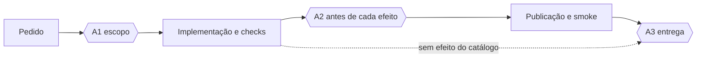

# Agent Skills Pipelines

[](https://github.com/talesgomes27/agent-skills-pipelines/actions/workflows/ci.yml)
[](LICENSE)
[](distribution/catalog.json)
[](https://www.python.org/)
[](docs/distribution/architecture.md)

Uma skill é uma pasta de instruções que um agente de IA, como o Claude Code, o Codex ou o Antigravity, lê quando a tarefa pede. Estas skills, em português, dão ao agente um processo de trabalho: planejar antes de programar, implementar em etapas verificadas, auditar código herdado e publicar só com a sua autorização. Foram pensadas para ciência de dados, sites e dashboards em Streamlit ou Shiny, e automações.

Release atual: **4.0.0**.

## Como é na prática

Você pede: *"Quero um dashboard em Streamlit com as vendas mensais por loja, publicado para a equipe."*

1. A `pre-code-pipeline` entra antes de qualquer código. Ela lê os dados, pergunta só o que muda a decisão e escreve a spec (`docs/spec.md`, com requisitos verificáveis) e o plano (`docs/plan.md`). Para uma vez, no **A1**, para você aceitar o escopo.
2. A `execution-pipeline` implementa o plano em fatias: lógica com testes, integração com os dados, telas, documentação e revisão. Para o Streamlit, ela usa a skill oficial do próprio Streamlit, se estiver instalada. Ela não para entre as etapas: mostra uma linha de status e grava a evidência.
3. Antes de cada efeito do catálogo do contrato comum, como commit, push, deploy, conta nova, instalação de dependência ou envio de dados a terceiros, o agente para no **A2** e diz o que vai fazer, onde e com qual conteúdo.
4. A `release-and-ops-pipeline` confere o que vai ser enviado, publica e testa o app publicado. A entrega termina no **A3**, com o diff, os checks rodados e o que ficou pendente.



Um pedido pequeno, como uma análise pontual ou a correção de um bug, passa por menos etapas: as pipelines ajustam o esforço ao risco e dizem qual escolheram. O esforço rigoroso acrescenta paradas depois da arquitetura e antes de migrações. Em qualquer modo, o agente para quando o escopo muda, surge uma decisão sua ou há risco de perder trabalho.

Prefere as paradas da 3.x, nos gates que cada pipeline marca para aceite? Ponha no `AGENTS.md` do projeto uma seção `## Pipelines` com a linha `- Modo: assistido`. A mesma seção lista os efeitos que você libera sem parada, como push da branch de trabalho; o [guia de instalação](docs/distribution/architecture.md#modo-e-efeitos-liberados-por-projeto) mostra o formato. Projetos com `docs/00` a `docs/05` ou com Spec Kit, Kiro e OpenSpec continuam no formato que já usam.

Você não precisa chamar as skills: o agente as escolhe pelo pedido. Para forçar uma, peça pelo nome; no Claude Code, as skills dos plugins têm o prefixo do plugin, como `pre-code-pipeline:pre-code-pipeline`.

As pipelines separam o trabalho em três tipos, cada um com as suas regras de teste e de publicação:

- **A ou `analise`, análise e modelos:** notebooks, machine learning, relatórios e Quarto.
- **B ou `aplicacao`, aplicações:** sites, APIs e dashboards em Streamlit ou Shiny.
- **C ou `automacao`, automações:** scripts, CLI, jobs agendados e ETL.

## Skills

Pipelines, que conduzem uma etapa inteira do trabalho, com paradas para o seu aceite:

| Skill | Quando entra |
|---|---|
| [`pre-code-pipeline`](pre-code-pipeline/SKILL.md) | Antes de programar: descoberta, escopo, arquitetura e plano. |
| [`execution-pipeline`](execution-pipeline/SKILL.md) | Para implementar um plano aprovado, com testes proporcionais à stack. |
| [`audit-and-refactoring-pipeline`](audit-and-refactoring-pipeline/SKILL.md) | Para entender e refatorar código ou notebooks herdados sem quebrar o que funciona. |
| [`release-and-ops-pipeline`](release-and-ops-pipeline/SKILL.md) | Para publicar: saneamento, versão, CI, deploy autorizado e teste do que foi publicado. |
| [`writing-pipeline`](writing-pipeline/SKILL.md) | Para redigir ou revisar documentos técnicos e de negócio sem perder fatos e fontes. |

Especialistas, que as pipelines chamam quando o assunto aparece:

| Skill | Quando entra |
|---|---|
| [`scheduled-automation`](scheduled-automation/SKILL.md) | Jobs agendados, ETL recorrente e retreino de modelo: estado, falhas, alertas e primeira execução. |
| [`personal-data`](personal-data/SKILL.md) | Dados de pessoas em análises, apps e listas, com base na LGPD. |
| [`quarto-expert`](quarto-expert/SKILL.md) | Ambiente e render de projetos Quarto, teses em ABNT e manuscritos com Binder. |
| [`skill-loader`](skill-loader/SKILL.md) | Buscar uma skill numa biblioteca externa grande, sem carregar tudo. Veja [biblioteca externa](docs/library-maintenance.md). |

## Instalação

### Claude Code

O repositório é um marketplace de plugins, com um plugin por skill e dois pacotes. Para o fluxo do exemplo acima, instale o pacote `essencial`, que traz as três pipelines e a `personal-data`:

```bash
claude plugin marketplace add talesgomes27/agent-skills-pipelines@stable
claude plugin install essencial@agent-skills-pipelines
```

O pacote `completo` instala as nove skills e o plugin [`pipeline-guardrails`](pipeline-guardrails/README.md), que pede a sua confirmação antes de push, tag, PR, deploy, migração e instalação de dependência, mesmo quando o agente esqueceria o A2. Ele também se instala sozinho, com `claude plugin install pipeline-guardrails@agent-skills-pipelines`. Os pacotes não têm conteúdo próprio: eles instalam os plugins das skills como dependências. Ao desinstalar um pacote, o Claude Code mantém essas dependências e sugere `claude plugin prune`, que remove só as que ele instalou automaticamente, não as que você instalou à mão.

Cada uma dessas três pipelines traz um subagente de revisão que o Claude Code pode chamar sozinho nesse ponto, ou que você chama pelo nome, como `@agent-pre-code-pipeline:plan-reviewer`: `plan-reviewer` revisa o plano antes do seu aceite, `diff-reviewer` revisa o diff no fim da implementação e `sanitation-checker` confere segredos, dados pessoais e arquivos grandes antes de publicar. Eles relatam e não editam.

Acrescente as outras skills da tabela uma a uma, com `claude plugin install <skill>@agent-skills-pipelines`. A branch `stable` só avança quando sai uma release, então você recebe só versões publicadas; para fixar uma versão exata, use uma tag, como `@v4.0.0`, no lugar de `@stable`. Sem o `@`, o marketplace acompanha a `main`, que muda a cada PR. Abra uma sessão nova para o Claude Code encontrá-las. No Claude Code, prefira o marketplace ao instalador abaixo: ele atualiza com `claude plugin update`.

### Codex, Antigravity e outros hosts

O instalador instala grupos de skills, os bundles. O `development` traz planejamento, execução, auditoria, automações e dados pessoais; o `research` troca a auditoria e as automações por escrita e Quarto. Com Python 3.9 ou mais novo:

```bash
git clone --branch stable https://github.com/talesgomes27/agent-skills-pipelines.git
cd agent-skills-pipelines
python3 -m venv .venv
.venv/bin/python -m pip install -r distribution/requirements.txt
# Mostra o que seria instalado, sem gravar nada
.venv/bin/python scripts/skills.py install --agent codex --bundle development --dry-run
.venv/bin/python scripts/skills.py install --agent codex --bundle development
```

Troque `codex` por `antigravity` ou `antigravity-cli`. No Windows, use `.venv\Scripts\python.exe`. Para atualizar, repita o comando com `--update`: cópias que você editou à mão não são sobrescritas.

O [guia de instalação](docs/distribution/architecture.md) tem os destinos de cada host, todos os bundles, a instalação por link e o que fazer quando uma instalação falha.

### Skills oficiais de frameworks

Para o conhecimento de cada framework, as pipelines usam as skills que os próprios fabricantes mantêm. Instale as que o seu trabalho usa:

| Framework | Skills | Instalação |
|---|---|---|
| Streamlit 1.58 ou mais novo | `developing-with-streamlit` | `streamlit skills` na pasta do projeto, ou `streamlit skills --global` |
| Shiny para Python | `shiny-for-python` | Na pasta do app, com o `shiny` no ambiente do projeto: `uvx library-skills --claude` no Claude Code, `uvx library-skills` nos outros hosts |
| Shiny em R e Posit Connect | `shiny-bslib`, `shiny-r-optimize`, `deploy-to-connect` e outras | `claude plugin marketplace add posit-dev/skills`, depois `claude plugin install shiny@posit-dev-skills` e `connect@posit-dev-skills`; nos outros hosts, `npx skills add posit-dev/skills` |
| Sites e apps na Vercel | `vercel-react-best-practices`, `web-design-guidelines`, `deploy-to-vercel` | `npx skills add vercel-labs/agent-skills` |
| Plataforma da Vercel | `auth`, `domains`, `env-vars`, `deployments-cicd`, `ai-sdk` e outras | `npx plugins add vercel/vercel-plugin` |
| Claude API e documentos | `claude-api`, `docx`, `pdf`, `pptx`, `xlsx` | `claude plugin marketplace add anthropics/skills`, depois `claude plugin install claude-api@anthropic-agent-skills` e `document-skills@anthropic-agent-skills` |
| Quarto (autoria e migração) | `quarto-authoring`, `brand-yml`, `alt-text` | Com o marketplace da Posit, `claude plugin install quarto@posit-dev-skills`; nos outros hosts, `npx skills add posit-dev/skills --skill quarto-authoring` |

As do Streamlit e do Shiny para Python vêm dentro da biblioteca e acompanham a versão instalada no projeto. O `library-skills` descobre o projeto pelo ambiente Python: numa pasta sem ambiente próprio, ele pode adotar a pasta pessoal e copiar a skill para `~/.claude/skills` e `~/.agents/skills`.

## Documentação

- [Guia de instalação](docs/distribution/architecture.md): destinos, bundles, atualização, recuperação e confirmação antes de publicar no Claude Code.
- [Verificação de descoberta](docs/distribution/discovery.md): como confirmar que o host encontra as skills.
- [Biblioteca externa](docs/library-maintenance.md): a `skill-loader` e a manutenção do índice.
- [Notas de manutenção](docs/maintainers.md): validação, contratos do doctor e CI.
- [Changelog](CHANGELOG.md) e [avisos de terceiros](NOTICE.md).

## Contribuir

As regras do repositório estão no [AGENTS.md](AGENTS.md), escrito para pessoas e agentes: limite de tamanho das skills, fontes oficiais, uma branch por mudança e como validar. Antes de abrir um PR, rode os testes, o doctor e o validador do plugin, com um Python que tenha o PyYAML:

```bash
python3 -m unittest discover -s tests
python3 scripts/skills.py doctor
claude plugin validate --strict .
```

## Licença

Distribuído sob a [licença MIT](LICENSE).
