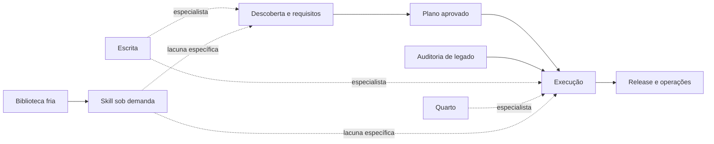

# Agent Skills Pipelines

[](https://github.com/talesgomes27/agent-skills-pipelines/actions/workflows/ci.yml)
[](LICENSE)
[](distribution/catalog.json)
[](https://www.python.org/)
[](docs/distribution/architecture.md)

Ecossistema modular de Agent Skills para planejar, implementar, auditar, documentar e entregar projetos com agentes de IA. Os mesmos pacotes podem ser distribuídos para OpenAI Codex, Claude Code, Google Antigravity e adaptadores customizados sem carregar toda a biblioteca no contexto.

Release atual: **3.2.0**.

## O que o projeto oferece

- Quatro pipelines com gates verificáveis, retomada de estado e modos assistido ou contínuo.
- Especialistas de escrita, Quarto e descoberta de skills externas.
- Instalação seletiva por skill ou bundle, por cópia ou link simbólico.
- Catálogo versionado, recibos de instalação e detecção segura de atualizações.
- Prompts de gatilho por skill para conferir a descoberta em cada host.
- CI em Linux, Windows e macOS.
- Biblioteca fria consultada sob demanda para reduzir exposição de instruções e consumo de contexto.

## Skills

| Skill | Responsabilidade |
|---|---|
| [`pre-code-pipeline`](pre-code-pipeline/SKILL.md) | Descoberta, requisitos, arquitetura, scaffold documental e plano verificável. |
| [`execution-pipeline`](execution-pipeline/SKILL.md) | Implementação de um plano aprovado e validação proporcional à stack. |
| [`audit-and-refactoring-pipeline`](audit-and-refactoring-pipeline/SKILL.md) | Reconhecimento, diagnóstico, caracterização e refatoração incremental. |
| [`release-and-ops-pipeline`](release-and-ops-pipeline/SKILL.md) | Saneamento, versão, artefatos, publicação autorizada e smoke tests. |
| [`scheduled-automation`](scheduled-automation/SKILL.md) | Contrato de jobs agendados, ETL recorrente e retreino: estado, idempotência, falhas, alertas e primeira execução. |
| [`personal-data`](personal-data/SKILL.md) | Dados pessoais em análises, apps, listas e coletas: inventário, minimização, saídas agregadas, envio a terceiros e vazamento, com base na LGPD. |
| [`writing-pipeline`](writing-pipeline/SKILL.md) | Redação e revisão técnica com preservação de fatos, fontes e formato. |
| [`quarto-expert`](quarto-expert/SKILL.md) | Ambiente e render de projetos Quarto, teses em ABNT e manuscritos com Binder. Para autoria e migração, use a `quarto-authoring` da Posit. |
| [`skill-loader`](skill-loader/SKILL.md) | Descoberta e carregamento limitado de skills em biblioteca externa. |

## Arquitetura operacional



As pipelines classificam o trabalho quando necessário em três arquétipos:

- **A — análise e modelos:** notebooks, ML, relatórios e Quarto.
- **B — aplicações:** sites, APIs, frontends e dashboards em Streamlit ou Shiny.
- **C — automações:** scripts, CLI, jobs agendados, ETL e empacotamento.

Skills especialistas são carregadas somente quando uma decisão depende delas. Graphify, MCPs e conectores são integrações opcionais; nenhuma delas amplia permissões ou autorização do usuário.

Planejamento, execução e auditoria ajustam esforço e documentação ao risco: leve, padrão ou rigoroso, com motivo registrado e contratos existentes reutilizados por referência. Esses níveis preservam os controles essenciais e não substituem os modos de aprovação assistido/contínuo.

## Instalação

### Claude Code

O repositório é um marketplace de plugins, com um plugin por skill:

```bash
claude plugin marketplace add talesgomes27/agent-skills-pipelines
claude plugin install execution-pipeline@agent-skills-pipelines
```

Troque `execution-pipeline` pelo nome de qualquer skill da tabela acima. As skills ficam com o prefixo do plugin, por exemplo `execution-pipeline:execution-pipeline`.

### Codex, Antigravity e outros hosts

Requisitos: Python 3.9 ou superior e PyYAML.

```bash
python3 -m venv .venv
.venv/bin/python -m pip install -r distribution/requirements.txt
.venv/bin/python scripts/skills.py list
.venv/bin/python scripts/skills.py install --agent codex --bundle development --dry-run
.venv/bin/python scripts/skills.py install --agent codex --bundle development
```

No Windows, use `.venv\Scripts\python.exe`. Os destinos padrão são:

| Ambiente | Projeto | Usuário |
|---|---|---|
| Codex | `.agents/skills/` | `~/.agents/skills/` |
| Claude Code | `.claude/skills/` | `~/.claude/skills/` |
| Antigravity App/IDE | `.agents/skills/` | `~/.gemini/config/skills/` |
| Antigravity CLI | `.agents/skills/` | `~/.gemini/antigravity-cli/skills/` |

Exemplos adicionais:

```bash
# Instalar todas, exceto a biblioteca fria
python3 scripts/skills.py install --agent codex --scope user --all --exclude skill-loader

# Desenvolvimento local com atualização imediata da fonte
python3 scripts/skills.py install --agent claude --bundle editorial --mode link

# Atualizar somente instalações gerenciadas e preservar edições locais
python3 scripts/skills.py install --agent codex --bundle development --update

# Destino de um framework customizado
python3 scripts/skills.py install --destination /caminho/skills --bundle research
```

A CLI não sobrescreve pacote homônimo sem recibo nem cópia gerenciada que tenha sido alterada localmente. Mudanças de release exigem `--update`. Consulte a [arquitetura de distribuição](docs/distribution/architecture.md) para bundles, manifests, recuperação e integração customizada.

### Skills oficiais de frameworks

Para dashboards, sites, apps com LLM e documentos, instale também as skills que os próprios fabricantes mantêm. As do Streamlit e do Shiny para Python vêm dentro da biblioteca e acompanham a versão instalada. As pipelines as usam como especialistas e mantêm seus gates e autorizações.

| Framework | Skills | Instalação |
|---|---|---|
| Streamlit 1.58 ou mais novo | `developing-with-streamlit` | `streamlit skills` na pasta do projeto, ou `streamlit skills --global` |
| Shiny para Python | `shiny-for-python` | Na pasta do app, com o `shiny` no ambiente do projeto: `uvx library-skills --claude` no Claude Code, `uvx library-skills` nos outros hosts |
| Shiny em R e Posit Connect | `shiny-bslib`, `shiny-r-optimize`, `deploy-to-connect` e outras | `claude plugin marketplace add posit-dev/skills`, depois `claude plugin install shiny@posit-dev-skills` e `connect@posit-dev-skills`; nos outros hosts, `npx skills add posit-dev/skills` |
| Sites e apps na Vercel | `vercel-react-best-practices`, `web-design-guidelines`, `deploy-to-vercel` | `npx skills add vercel-labs/agent-skills` |
| Plataforma da Vercel | `auth`, `domains`, `env-vars`, `deployments-cicd`, `ai-sdk` e outras | `npx plugins add vercel/vercel-plugin` |
| Claude API e documentos | `claude-api`, `docx`, `pdf`, `pptx`, `xlsx` | `claude plugin marketplace add anthropics/skills`, depois `claude plugin install claude-api@anthropic-agent-skills` e `document-skills@anthropic-agent-skills` |
| Quarto (autoria e migração) | `quarto-authoring`, `brand-yml`, `alt-text` | Com o marketplace da Posit, `claude plugin install quarto@posit-dev-skills`; nos outros hosts, `npx skills add posit-dev/skills --skill quarto-authoring` |

O `library-skills` descobre o projeto pelo ambiente Python. Numa pasta sem ambiente próprio, ele pode adotar a pasta pessoal como projeto e copiar a própria skill para `~/.claude/skills` e `~/.agents/skills`.

## Bundles

Os bundles agrupam skills por papel; eles não instalam ferramentas, MCPs ou dependências externas:

| Bundle | Finalidade |
|---|---|
| `planning` | Planejamento pré-código. |
| `development` | Planejamento, execução, auditoria, automações agendadas e dados pessoais. |
| `editorial` | Escrita e revisão técnica. |
| `research` | Planejamento, execução, escrita, Quarto e dados pessoais. |
| `release` | Release e operações. |
| `library` | Carregamento da biblioteca fria. |

## Biblioteca fria

A `skill-loader` resolve a raiz por argumento explícito, configuração do projeto em `.agents/skills-library.json`, configuração do usuário em `~/.config/agent-skills/library.json` ou `SKILLS_LIBRARY_ROOT`. O índice fica fora do contexto até uma busca delimitada.

```bash
python3 skill-loader/scripts/library_query.py exact database-architect
python3 skill-loader/scripts/library_query.py search "database architecture" --limit 5
python3 scripts/library.py doctor --root /caminho/da/biblioteca
python3 scripts/library.py rebuild --root /caminho/da/biblioteca --output /tmp/skills_index.candidate.json
```

O carregador valida confinamento, existência e identidade do manifesto. Encontrar uma skill não a executa nem concede novas permissões. Veja [manutenção da biblioteca](docs/library-maintenance.md).

## Validação

```bash
python3 scripts/skills.py doctor
python3 -m unittest discover -s tests -v
python3 quarto-expert/scripts/doctor.py
```

O doctor valida estrutura, frontmatter, identidade e links das skills. A CI repete testes, doctor e instalações temporárias em Linux, Windows e macOS. Para saber se o host encontra as skills, siga a [verificação de descoberta](docs/distribution/discovery.md), que traz os prompts de gatilho de cada skill.

## Documentação

- [Changelog](CHANGELOG.md)
- [Avisos de terceiros](NOTICE.md)
- [Arquitetura de distribuição](docs/distribution/architecture.md)
- [Verificação de descoberta](docs/distribution/discovery.md)
- [Manutenção da biblioteca fria](docs/library-maintenance.md)

Recursos executáveis de cada pacote são resolvidos relativamente à sua própria pasta; a distribuição não depende de caminhos pessoais. Auditorias, experimentos e o harness de avaliações até a MOD-010 estão preservados na tag `archive/mod-2026-10`.

## Licença

Distribuído sob a [licença MIT](LICENSE).
