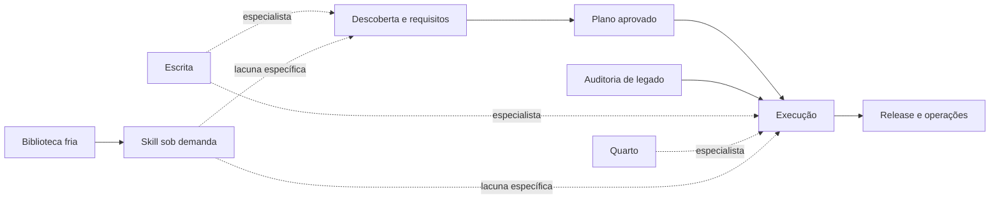

# Agent Skills Pipelines

[](https://github.com/talesgomes27/agent-skills-pipelines/actions/workflows/ci.yml)
[](LICENSE)
[](distribution/catalog.json)
[](https://www.python.org/)
[](docs/distribution/architecture.md)

Ecossistema modular de Agent Skills para planejar, implementar, auditar, documentar e entregar projetos com agentes de IA. Os mesmos pacotes podem ser distribuídos para OpenAI Codex, Claude Code, Google Antigravity e adaptadores customizados sem carregar toda a biblioteca no contexto.

Release atual: **1.0.1**.

## O que o projeto oferece

- Cinco pipelines com gates verificáveis, retomada de estado e modos assistido ou contínuo.
- Especialistas de escrita, Quarto e descoberta de skills externas.
- Instalação seletiva por skill ou bundle, por cópia ou link simbólico.
- Catálogo versionado, recibos de instalação e detecção segura de atualizações.
- Avaliações comportamentais positivas, ambíguas e negativas para cada skill.
- CI em Linux, Windows e macOS.
- Biblioteca fria consultada sob demanda para reduzir exposição de instruções e consumo de contexto.

## Skills

| Skill | Responsabilidade |
|---|---|
| [`pre-code-pipeline`](pre-code-pipeline/SKILL.md) | Descoberta, requisitos, arquitetura, scaffold documental e plano verificável. |
| [`execution-pipeline`](execution-pipeline/SKILL.md) | Implementação de um plano aprovado e validação proporcional à stack. |
| [`audit-and-refactoring-pipeline`](audit-and-refactoring-pipeline/SKILL.md) | Reconhecimento, diagnóstico, caracterização e refatoração incremental. |
| [`release-and-ops-pipeline`](release-and-ops-pipeline/SKILL.md) | Saneamento, versão, artefatos, publicação autorizada e smoke tests. |
| [`writing-pipeline`](writing-pipeline/SKILL.md) | Redação e revisão técnica com preservação de fatos, fontes e formato. |
| [`quarto-expert`](quarto-expert/SKILL.md) | Autoria, configuração, depuração e migração de projetos Quarto. |
| [`humanizer`](humanizer/SKILL.md) | Revisão de estilo preservando significado e voz do autor. |
| [`skill-loader`](skill-loader/SKILL.md) | Descoberta e carregamento limitado de skills em biblioteca externa. |

## Arquitetura operacional



As pipelines classificam o trabalho quando necessário em três arquétipos:

- **A — dados, análise e publicação:** notebooks, ML, relatórios e Quarto.
- **B — software, APIs e interfaces:** serviços, aplicações e frontends.
- **C — CLI, scripts e automação:** comandos, empacotamento e operações locais.

Skills especialistas são carregadas somente quando uma decisão depende delas. Graphify, MCPs e conectores são integrações opcionais; nenhuma delas amplia permissões ou autorização do usuário.

Planejamento, execução e auditoria ajustam esforço e documentação ao risco: leve, padrão ou rigoroso, com motivo registrado e contratos existentes reutilizados por referência. Esses níveis preservam os controles essenciais e não substituem os modos de aprovação assistido/contínuo.

## Instalação

Requisitos: Python 3.9 ou superior e PyYAML.

```bash
python3 -m venv .venv
.venv/bin/python -m pip install -r distribution/requirements.txt
.venv/bin/python scripts/skills.py list
.venv/bin/python scripts/skills.py install --agent codex --bundle development --dry-run
.venv/bin/python scripts/skills.py install --agent codex --bundle development
```

No Windows, use `.venv\Scripts\python.exe`. Os destinos padrão são:

| Ambiente | Projeto | Usuário |
|---|---|---|
| Codex | `.agents/skills/` | `~/.agents/skills/` |
| Claude Code | `.claude/skills/` | `~/.claude/skills/` |
| Antigravity App/IDE | `.agents/skills/` | `~/.gemini/config/skills/` |
| Antigravity CLI | `.agents/skills/` | `~/.gemini/antigravity-cli/skills/` |

Exemplos adicionais:

```bash
# Instalar todas, exceto uma implementação já fornecida pelo host
python3 scripts/skills.py install --agent codex --scope user --all --exclude humanizer

# Desenvolvimento local com atualização imediata da fonte
python3 scripts/skills.py install --agent claude --bundle editorial --mode link

# Atualizar somente instalações gerenciadas e preservar edições locais
python3 scripts/skills.py install --agent codex --bundle development --update

# Destino de um framework customizado
python3 scripts/skills.py install --destination /caminho/skills --bundle research
```

A CLI não sobrescreve pacote homônimo sem recibo nem cópia gerenciada que tenha sido alterada localmente. Mudanças de release exigem `--update`. Consulte a [arquitetura de distribuição](docs/distribution/architecture.md) para bundles, manifests, recuperação e integração customizada.

## Bundles

Os bundles agrupam skills por papel; eles não instalam ferramentas, MCPs ou dependências externas:

| Bundle | Finalidade |
|---|---|
| `planning` | Planejamento pré-código. |
| `development` | Planejamento, execução e auditoria. |
| `editorial` | Escrita e humanização. |
| `research` | Planejamento, execução, escrita e Quarto. |
| `release` | Release e operações. |
| `library` | Carregamento da biblioteca fria. |

## Biblioteca fria

A `skill-loader` resolve a raiz por argumento explícito, configuração do projeto em `.agents/skills-library.json`, configuração do usuário em `~/.config/agent-skills/library.json` ou `SKILLS_LIBRARY_ROOT`. O índice fica fora do contexto até uma busca delimitada.

```bash
python3 skill-loader/scripts/library_query.py exact database-architect
python3 skill-loader/scripts/library_query.py search "database architecture" --limit 5
python3 scripts/library.py doctor --root /caminho/da/biblioteca
python3 scripts/library.py rebuild --root /caminho/da/biblioteca --output /tmp/skills_index.candidate.json
```

O carregador valida confinamento, existência e identidade do manifesto. Encontrar uma skill não a executa nem concede novas permissões. Veja [manutenção da biblioteca](docs/library-maintenance.md).

## Avaliação e validação

```bash
python3 scripts/skills.py doctor
python3 scripts/evals.py validate
python3 -m unittest discover -s tests -v
python3 quarto-expert/scripts/doctor.py
```

O harness contém 28 casos para as oito skills e classifica traces A/B capturados por um executor externo. Ele mede ativação, operações proibidas, sinais esperados e, quando fornecidos, tokens, chamadas de ferramenta e latência. Veja [avaliações comportamentais](docs/evals.md) e [verificação de descoberta](docs/distribution/discovery.md).

O workflow de CI repete testes, doctors e instalações temporárias em Linux, Windows e macOS. Validação estrutural não substitui uma execução real no host, renderização dos formatos solicitados ou revisão humana do resultado.

## Documentação

- [Governança documental e fontes canônicas](docs/distribution/architecture.md#governança-documental-vigente)
- [Arquitetura de distribuição](docs/distribution/architecture.md)
- [Protocolo de descoberta](docs/distribution/discovery.md)
- [Validação da distribuição](docs/distribution/validation.md)
- [Avaliações comportamentais](docs/evals.md)
- [Manutenção da biblioteca fria](docs/library-maintenance.md)
- [Auditorias e decisões de refatoração](docs/audits/)

Os diretórios `docs/audits/legacy/` e `docs/audits/proposals/` preservam histórico e não fazem parte do catálogo ativo. Recursos executáveis de cada pacote são resolvidos relativamente à sua própria pasta; a distribuição não depende de caminhos pessoais.

## Licença

Distribuído sob a [licença MIT](LICENSE).
