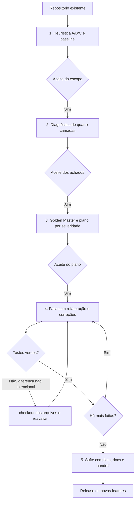

# Auditoria individual: audit-and-refactoring-pipeline

Data: 2026-10-22. Fase 1, quarta meta-skill. Writing-pipeline aprovada consolidada, com três referências ativas e as sete anteriores preservadas em docs/audits/legacy. O README teve apenas sua linha de inventário da escrita ajustada. Não houve sincronização de perfis globais. A meta-skill auditada e suas quatro referências permanecem intactas; proposta em `docs/audits/proposals/audit-and-refactoring-pipeline/`.

Atualização após aprovação do usuário: o pacote proposto foi consolidado em `audit-and-refactoring-pipeline/`, mantendo os quatro nomes das referências. A análise e as medidas abaixo descrevem o estado anterior à aprovação. Nenhum perfil global foi sincronizado.

## Parecer

Preservar cinco gates, diagnóstico sem edição, caracterização, fatias e handoff. Corrigir a recuperação destrutiva, separar comportamento preservado de correção funcional e substituir a promessa de ausência total de regressões por evidência limitada ao escopo verificado. Remover modernizações obrigatórias e severidade baseada em preferências de stack/apresentação.

## 1. Raio-X

- Frontmatter name/description: auditoria multicamadas e refatoração de Brownfield A/B/C em cinco gates. Não há modo audit-only explícito que encerre o fluxo sem sugerir execução.
- Entradas: repositório existente, metadados de arquétipo ou heurística de classificação, testes e regras de qualidade.
- Saídas: docs/00_archetype.md, task.md, docs/audit-report.md, tests/characterization e docs/refactoring-plan.md; código/docs alterados somente após aceite de G3 no fluxo descrito.
- Privilegio: herdado do host e credenciais. A promessa de somente leitura do código não isola efeitos de imports, testes, notebooks ou geração de grafo.
- Ferramentas: terminal/filesystem/Git; possíveis bancos, web, scanners e agentes acionados pelas sub-skills. Não há servidor MCP declarado no pacote.

| Superfície | Uso e risco | Limite proposto |
|---|---|---|
| Git/arquivos | Inspeção, edição, rollback e possível commit | Preservar base suja e trabalho concorrente; recuperação só da própria fatia |
| Aplicação/testes | Baseline, snapshots, execução integrada | Conferir efeitos, destino, dados e runner real |
| Dados/relatórios | Reexecução, modelos, figuras e migrações | Preservar bruto; distinguir equivalência de alteração metodológica |
| Segurança/scanners | Candidatos de vulnerabilidade e segredos | Evidência contextual; sem copiar credenciais ou executar exploit por inferência |
| Skills/agentes | Muitas revisões e planejadores potenciais | Escopo por necessidade, sem delegação automática |
| MCP | Possível acesso remoto | Menor catálogo e autorização do destino, sem servidor novo por padrão |

## 2. Fluxo atual



O diagrama mostra o comportamento descrito, não a execução desta auditoria. A proposta acrescenta saída audit-only após G2 e recuperação sem descarte de alterações anteriores/concorrentes.

### Dependências

42 nomes distintos de especialistas citados nas listas, corpo e matriz, excluindo skill-loader como infraestrutura, Graphify como CLI e pipelines de destino. 38 SKILL.md foram localizados nas pastas consultadas. `ponytail-audit`, `ponytail-review`, `ml-best-practices` e `notebook-guidance` não têm entradas nessas pastas; são citados como plugins, cuja disponibilidade não foi inferida dessa ausência.

| Gate | Dependências/grupos |
|---|---|
| 1 | planning-with-files, senior-architect, architecture-patterns, domain-driven-design, brooks-audit, production-code-audit, framework-migration-legacy-modernize |
| 2 código/segurança | clean-code, code-reviewer, code-review-excellence, simplify-code, systematic-debugging, ponytail-audit/review, clean-code-guard, logic-lens, security-audit; code-audit listado no cold storage |
| 2 testes/documentos | test-guard, pytest-skill, docs-guard, writing-pipeline |
| 2 analítico | data-quality-frameworks, data-scientist, analytics, matplotlib, plotly, quarto-expert, ml-best-practices, notebook-guidance, weather-data-reproducibility |
| 3 | pytest-skill, tdd-workflow, test-guard, code-refactoring-tech-debt, brooks-debt, writing-pipeline |
| 4 | code-refactoring-refactor-clean, polars, data-scientist, matplotlib, plotly, quarto-expert, writing-pipeline, humanizer, seaborn, clean-code, simplify-code, architecture-patterns, complexity-cuts, orchestrate-batch-refactor, repo-native-refactor, ponytail-audit |
| 5 | test-guard, docs-guard, architecture-decision-records, writing-pipeline, clean-code-guard |

Os conteúdos dos orquestradores/recursos relevantes aos achados foram inspecionados, não executados como skills. Não se trata de auditoria independente completa das 42 dependências.

### Achados priorizados

| ID | Gravidade | Evidência | Correção |
|---|---|---|---|
| AU-01 | Alta | Characterization manda `git checkout -- <arquivos>` após falha. Restaura índice, não a base real anterior à fatia. | Capturar base e reverter só mudanças próprias; preservar usuário e concorrência. |
| AU-02 | Alta | Refatoração preserva comportamento, mas G4 manda eliminar leakage, mudar seeds, contratos API, CLI e bibliotecas. | Classificar refatoração, correção, migração e otimização com aceite e oráculo próprios. |
| AU-03 | Alta | Exceção de testes só permite corrigir P0; matriz manda P0 sempre na primeira fatia. | Toda mudança funcional aprovada exige critério próprio; ordenar também por dependência e rede de segurança. |
| AU-04 | Alta | G5 promete ausência total de regressões a partir de exit code 0. | Relatar ausência de regressões detectadas no escopo/testes executados, com limitações. |
| AU-05 | Alta | G1/2 allowlist de arquivos conflita com graphify inicial gerando artefatos; executar testes pode ter efeitos. | Diferenciar leitura de execução e autorizar destino/efeitos dos artefatos. |
| AU-06 | Média | G1 exige stack uv/Ruff/pytest e G4 migra ambiente; isso pode não pertencer ao escopo ou linguagem. | Preservar stack e usar runner do projeto; migração como tarefa separada. |
| AU-07 | Média | Gate3 assume 20–100 linhas, soma/shape/dtype e tolerância fixa como proteção. | Casos e oráculos representativos; tolerância fundamentada; snapshot não é prova universal. |
| AU-08 | Média | Heurística chamada determinística mapeia notebook/Dockerfile para arquétipo único. | Propor por evidência e confirmar escopo híbrido. |
| AU-09 | Média | Seed/freeze/CRISP/DPI/pt-BR e complexidade fixam P0/P1/P2 automaticamente. | Severidade por cenário, impacto, confiança e requisitos. |
| AU-10 | Média | Graphify classifica hubs como candidatos P0/P1 e sugere profundidade para ordenar testes. | Centralidade/caminhos orientam investigação, não provam prioridade ou segurança. |
| AU-11 | Média | Broader suites são repetidas a cada fatia, junto com renderização e várias guardas. | Checks afetados por fatia e integração obrigatória no fechamento/risco. |
| AU-12 | Média | planning-with-files usa arquivos próprios; refactoring/reviewers impõem processos e paralelismo. | Um estado e plano; especialistas por lacuna, sem novo controlador. |
| AU-13 | Média | brooks-audit exige três ../_shared ausentes; brooks-debt exige common ausente. | Verificar pacote completo antes de depender de especialista. |
| AU-14 | Média | weather-data-reproducibility é acionada genericamente para A, mas trata weather/GRIB/NetCDF específicos. | Usar somente se os dados tiverem esse domínio; reter princípio de proveniência. |
| AU-15 | Média | Allowlist G3 não contempla fixtures/snapshots/harness que a caracterização pode exigir. | Autorizar artefatos de proteção no plano sem abrir edição arbitrária de produção. |
| AU-16 | Média | G5 manda marcar todos os gates aprovados e não tem modo só diagnóstico. | Registrar apenas aceites reais, dispensas e saída sem refatoração. |
| AU-17 | Média | Índices/migrações, scanner e reexecução podem atingir dados e serviços reais. | Ambiente isolado e autorização do efeito/destino. |
| AU-18 | Média | Paths pessoais e referências a outros pacotes locais tornam instalação parcial frágil. | Recursos internos relativos e descoberta de capacidades do host. |

Verificado no filesystem: `brooks-audit/architecture-guide.md` existe, mas `../_shared/common.md`, `source-coverage.md` e `decay-risks.md` não existem na instalação consultada. A falta desses arquivos é problema de integridade do pacote local, não evidência de obsolescência upstream.

### Limite demonstrado de um oráculo

Vetores [1,2] e [0,3] têm a mesma dimensão, dtype inteiro, nulos e soma; seus valores diferem. Um teste que congele apenas esses agregados não detecta essa alteração. O exemplo foi calculado localmente sem alterar aplicação. Isso demonstra um limite do oráculo, não implica que toda caracterização precise comparar bytes completos.

## 3. Alternativas modernas e limites

| Capacidade | Alternativa | Benefício e limite |
|---|---|---|
| Caracterização | Runner existente, asserts de contrato e snapshot/ApprovalTests quando apropriado | Proteção revisável de saídas; baseline precisa ser inspecionada e representativa |
| Isolamento de I/O | tmp_path/fixtures equivalentes e fronteiras externas controladas | Evita gravar dados do usuário; mocks não substituem integração exigida |
| Segurança estática | Semgrep com regras/destinos conhecidos, ou scanner já configurado | Candidatos reproduzíveis; falsos positivos, regras, telemetria e cobertura precisam ser conhecidos |
| Refatoração localizada | repo-native-refactor sob demanda | Já diferencia revisão/edição, base suja, risco e contratos; não empilhar todo seu processo por padrão |
| Transformações de código | IDE/refactor nativo ou codemod da linguagem | Ajuda a renomear/transformar sintaxe; não garante contratos externos/dinâmicos |
| Arquitetura | Diff, busca e grafo opcional com cobertura | Navegação dirigida sem assumir severidade por centralidade |
| Banco/MCP | Ferramenta de fonte já autorizada com escopo mínimo | Evidência de schema/comportamento, sem servidor novo nem migração implícita |
| Orquestração | Plano de fatias único; paralelismo somente independente | Reduz conflitos e contexto; não pressupõe agentes específicos em todos os hosts |

A documentação do Git confirma que checkout de caminho descarta mudanças unstaged. A definição de refatoração de Fowler preserva comportamento observável. ApprovalTests é alternativa de snapshot, não obrigação. Semgrep executa regras; um resultado sem achados não certifica segurança. Nenhuma dessas ferramentas foi instalada nesta rodada.

## 4. Matriz de decisão

Retirar do padrão não significa desinstalar a biblioteca.

| Decisão | Elementos | Destino |
|---|---|---|
| Manter | Gates, diagnóstico em quatro camadas, rede de segurança e fatias | Núcleo com fronteiras de autorização claras |
| Manter | Schema de achados e integração writing Modo2 | Evidências, impacto e estado por ID |
| Manter condicional | systematic-debugging, test-guard, docs-guard, clean-code-guard | Lacuna concreta da fatia/revisão |
| Manter condicional | data-scientist, qualidade, Polars, gráficos e quarto-expert | Só stack/método/formatos aplicáveis |
| Manter condicional | repo-native-refactor, complexity-cuts | Problema demonstrado e escopo delimitado |
| Substituir | planning-with-files | task.md como único índice de estado |
| Substituir carga acumulada | senior-architect, DDD, patterns, múltiplos code-reviewers e audits | Uma análise dirigida; especialista escolhido pela necessidade |
| Substituir regra | pytest/tdd obrigatórios para caracterização | Runner e contratos da stack; caracterização atual separada de teste de requisito corrigido |
| Substituir | checkout universal e freeze de agregados | Recuperação por fatia e oráculos com poder de detecção relevante |
| Retirar do padrão | framework-migration-legacy-modernize; migração para uv; brooks-debt | Migração/dívida somente quando parte do plano aprovado |
| Retirar do padrão | weather-data-reproducibility | Especialista apenas para domínio meteorológico |
| Reduzir | simplify-code, orchestrate-batch-refactor e ponytail em todas as fases | Revisão/delegação proporcional, sem circuito paralelo obrigatório |
| Corrigir | Matriz de severidade e atalhos Graphify | Impacto e evidência, não indicador estrutural ou preferência estética |
| Corrigir | Humanizer/revisão editorial como autoridade de diagnóstico factual | Escrita evidencia achados; fatos vêm de código/dados/fontes |
| Corrigir | Handoff e todos gates aprovados | Aceites reais e autorização distinta para publicar |

## 5. Proposta

O pacote preserva os quatro nomes de referências existentes, agora com escopo e conteúdo corrigidos. O núcleo roteia por gate; apenas A carrega o checklist analítico. Não há schema MCP ou frontmatter proprietário.

```
audit-and-refactoring-pipeline/
├── SKILL.md
└── references/
    ├── characterization-tests.md
    ├── severity-matrix-and-triage.md
    ├── refactoring-patterns-abc.md
    └── archetype-a-analytics-audit.md
```

Mantém docs/00, task.md, audit-report e refactoring-plan para interoperabilidade com as versões aprovadas de planejamento, execução e escrita. Não exige uma aplicação Python ou classifica notebook isolado como projeto A. Recuperação e mudança funcional estão explícitas, sem exigir novos scripts ou servidores.

## 6. Verificação e avaliação pendente

O quick_validate.py retornou `Skill is valid!` para a proposta e para as três meta-skills consolidadas. Referências locais foram resolvidas e `git diff --check` passou. `git diff --exit-code -- audit-and-refactoring-pipeline` confirmou o pacote vigente intacto. A writing-pipeline consolidada foi comparada byte a byte com a proposta aprovada, com os mesmos quatro arquivos ativos. Não se executou a aplicação auditada, nenhum rollback, migração, scanner remoto, teste de produção ou refatoração do código-alvo. A caracterização proposta ainda requer avaliação comportamental em fixtures isoladas.

| Conteúdo | Original | Proposta | Redução |
|---|---:|---:|---:|
| Núcleo, caracteres | 17.398 | 8.741 | 49,8% |
| Núcleo, linhas | 218 | 66 | — |
| Pacote completo, caracteres | 28.771 | 20.437 | 29,0% |
| Referências | 4 | 4 | — |

Contagens de caracteres Unicode. A referência de recuperação ficou mais detalhada para corrigir riscos concretos; o pacote não deve ser carregado integralmente em todo gate. Não houve medição de tokens/latência nem prova de equivalência entre execuções de agentes.

| Cenário de avaliação | Critério observável |
|---|---|
| Pedido apenas de diagnóstico | Encerrar sem escrever aplicação ou criar testes |
| Arquivo com edição prévia do usuário | Recuperação preserva essa edição após falha da própria fatia |
| Alteração concorrente no mesmo trecho | Preservar diff e interromper recuperação insegura |
| Refatoração altera serialização | Detectar e bloquear diferença não autorizada |
| Correção P1 aprovada | Teste do contrato desejado, sem exigir prioridade P0 |
| P0 depende de preparação | Planejar proteção/contenção autorizada antes da edição crítica |
| Saídas com mesmo shape/soma e valores diferentes | Oráculo relevante detecta diferença |
| CLI shell / serviço TS | Não impor Python, src ou pytest |
| Notebook incidental no serviço | Classificação segue escopo e evidências, sem roteamento automático errado |
| Scanner sem achados | Não declarar segurança certificada |
| Falha preexistente da suíte | Distinguir da regressão e manter limitação no aceite |
| Leakage corrigido | Tratar alteração de resultados como correção, não equivalência |
| Grafo parcial com hub | Não atribuir P0/P1 só pela centralidade |

Comparar mesmo modelo, fixture e permissões: preservação de alterações, achados confirmados, acerto de triagem, detecção de regressão, evidência dos checks, tokens, chamadas e tempo. Não converter redução textual em promessa de performance.

## Fontes oficiais consultadas

- [Git checkout](https://git-scm.com/docs/git-checkout): substituição de arquivos a partir do índice e descarte de alterações unstaged.
- [Fowler: definição de refatoração](https://martinfowler.com/bliki/DefinitionOfRefactoring.html): preservação do comportamento observável.
- [ApprovalTests Python](https://github.com/approvals/ApprovalTests.Python): abordagem de approvals/snapshots.
- [pytest tmp_path](https://docs.pytest.org/en/stable/how-to/tmp_path.html) e [monkeypatch](https://docs.pytest.org/en/stable/how-to/monkeypatch.html): isolamento de arquivos e fronteiras.
- [Semgrep regras](https://docs.semgrep.dev/running-rules) e [metrics](https://docs.semgrep.dev/metrics): varredura e controle de coleta.
