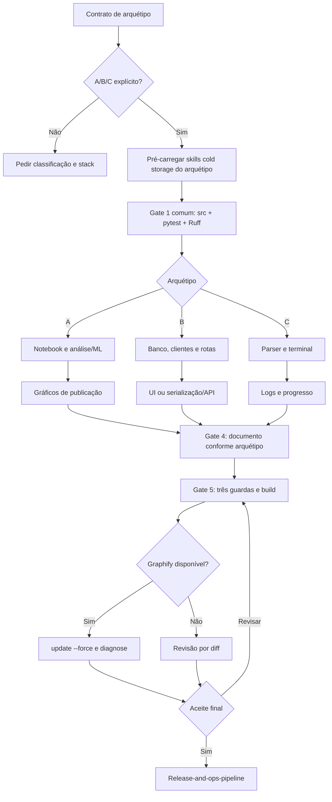

# Auditoria individual: execution-pipeline

Data: 2026-10-22. Fase 1, segunda meta-skill. A versão aprovada da pre-code-pipeline foi consolidada no repositório; a execution-pipeline continua inalterada. A proposta completa fica em `docs/audits/proposals/execution-pipeline/` e não está instalada. Release e escrita são tratadas apenas como contratos de integração.

Atualização após aprovação do usuário: o pacote proposto foi consolidado em `execution-pipeline/SKILL.md` e `execution-pipeline/references/` no repositório. A análise abaixo descreve a versão anterior e as verificações da proposta. Perfis globais não foram sincronizados.

## Parecer

Manter os cinco gates e a revisão de código, testes e documentação. Refatorar o núcleo para comandos da stack real, dependências por capacidade e referências A/B/C carregadas sob demanda. Skill instrutiva, biblioteca executável e autorização são três coisas distintas. Um MCP não elimina essa distinção nem prova funcionamento.

## 1. Raio-X

- Frontmatter: `name: execution-pipeline` e descrição de implementação pós-planejamento, testes e documentação para A/B/C; sem trigger separado ou restrição declarativa de ferramentas.
- Entrada atual: docs/00_archetype.md ou declaração explícita em PRD/plano/pedido. A referência de gerado_por exemplifica apenas pre-code, embora auditoria também encaminhe novas capacidades.
- Responsabilidade: lógica → integração → apresentação → documentação → auditoria/build; handoff para release.
- Estado: task.md, sem contrato explícito de namespace entre pré-código e execução, retomada ou resultados parciais.
- Privilégios efetivos: os do host, sandbox, conta de banco, ferramentas e plugins. A skill permite escrita de aplicação, execução de scripts/notebooks/testes/build, migrações e geração de artefatos; não define isolamento próprio.
- MCP: não há servidor ou schema declarado. Plugins notebook-guidance e ponytail são referências operacionais, não dependências distribuídas neste repositório.

| Superfície | Operações | Limite de plataforma recomendado |
|---|---|---|
| Filesystem | Código, testes, docs, notebooks, caches e figuras | Preservar diff do usuário, fontes brutas e informações sensíveis |
| Terminal | Testes, lint, build, notebook e Graphify | Comandos da stack, ambiente controlado e resultados registrados |
| Banco e APIs | Clientes externos, persistência, migrações | Destino de desenvolvimento/teste; ações externas só no escopo autorizado |
| Navegador | Validação de UI, Swagger e E2E | Jornadas afetadas e critérios observáveis; sem efeitos reais em contas por acidente |
| Bibliotecas/plugins | Revisão, dados e documentação | Disponibilidade verificada; sem fingir carregamento ou execução |

## 2. Fluxo atual e decisões



Os Gates 1–4 também têm critérios de validação/aceite, mas o texto não uniformiza a persistência dessas aprovações nem separa a fase no task.md. A proposta explicita o contrato sem exigir aprovação por cada pequena edição.

### Inventário de dependências

29 nomes distintos entre corpo e matriz de rastreabilidade, excluindo skill-loader como infraestrutura, release como destino e Graphify/uv/pytest como CLIs. 27 SKILL.md localizados nas pastas do repositório e da biblioteca pessoal; 2 nomes, notebook-guidance e ponytail, sem entrada nessas pastas ou no texto do índice frio. Podem existir em plugins: a busca não prova sua indisponibilidade em todo host. Nenhum plugin foi instalado ou executado.

| Gate | Skills citadas |
|---|---|
| 1 | clean-code; python-pro; tdd-workflow; pytest-skill; writing-pipeline |
| 2 A | notebook-guidance; polars; scikit-learn; statsmodels; ponytail; data-scientist na matriz |
| 2 B/C | database-design; api-documentation; fastapi-pro; python-pro; ponytail |
| 3 A | matplotlib; seaborn; plotly |
| 3 B/C | frontend-design; react-patterns; tailwind-design-system; python-pro; clean-code |
| 4 | writing-pipeline; data-storytelling; humanizer; quarto-expert; documentation-templates |
| 5 | clean-code-guard; test-guard; docs-guard; simplify-code; quarto-expert; webapp-testing |

Os 27 arquivos de entrada somam 186.195 caracteres, sem referências e transitivas. É superfície potencial; não significa que uma execução carregue todos. A estrutura das dependências foi inventariada, com leitura dirigida das regras relevantes aos achados; isso não constitui auditoria completa de cada biblioteca.

### Achados priorizados

| ID | Gravidade | Evidência | Consequência e correção |
|---|---|---|---|
| EX-01 | Alta | G1 obriga uv/pytest/Ruff/src em todos os arquétipos; B final também fixa pytest-cov. | TS, shell e R podem ser bloqueados sem motivo; derivar checks da stack e plano. |
| EX-02 | Alta | Falta de skill seaborn/guard/notebook bloqueia execução; falta de skill DuckDB leva a criar skill ou substituir por Polars. | Conhecimento instrutivo confundido com runtime; verificar capacidade e preservar tecnologia exigida. |
| EX-03 | Alta | Não verifica explicitamente aprovação do plano e autorização de implementar antes de G1. | Entrada direta pode iniciar código apenas por haver archetype; exigir evidência e escopo. |
| EX-04 | Alta | Migrações e execução de notebook não explicitam destino/efeitos. | Risco de escrita em base real ou fontes brutas; usar ambiente de teste autorizado. |
| EX-05 | Alta | G4 exige freeze: auto e G5 render, sem revalidação quando dados externos mudam. | Relatório pode renderizar com resultados antigos; identificar dados, ambiente e execução efetiva. |
| EX-06 | Média | G1 associa ruff check a linting e formatação; tipagem estrita não possui check próprio. | Falsa comprovação; separar lint, formato e tipos conforme configuração. |
| EX-07 | Média | Pré-checagem manda carregar todas as skills cold do arquétipo antes do código. | Contradiz carregamento sob demanda; carregar por gate e lacuna. |
| EX-08 | Média | simplify-code local propõe quatro papéis de revisão paralela para diffs amplos; guardas adicionam regras e referências. | Amplificação de contexto/revisão; manter perspectivas e limitar escopo/delegação. |
| EX-09 | Média | A exige notebook executado, relatório com modelagem, SHAP/resíduos e vários formatos. | Analytics e Quarto direto recebem trabalho extra; aplicar somente entregáveis aprovados. |
| EX-10 | Média | Seed é associada a reprodutibilidade estrita, sem dados/backend/ambiente. | Reprodutibilidade não demonstrada; registrar proveniência e limites de determinismo. |
| EX-11 | Média | webapp-testing local exige networkidle e sugere wait_for_timeout. | Espera frágil ou ilimitada para app com tráfego; usar locators e asserções de estado. |
| EX-12 | Média | Dados sintéticos são proibidos sem distinguir resultados de fixtures; anti-wrappers é amplo. | Possível descarte de testes isolados e abstrações nativas úteis; distinguir fixtures, dados reais e Pipeline. |
| EX-13 | Média | Graphify update --force torna-se rotina se binário existe, sem checar grafo/cobertura. | Binário não prova índice adequado; atualizar grafo mantido apenas quando afetado, sem force genérico. |
| EX-14 | Média | Apenas task.md registra entrega, sem linha de base, falhas preexistentes ou namespace de fase. | Retrabalho e aprovações ambíguas; registrar execução separadamente do pré-código. |
| EX-15 | Média | Paths de um perfil Gemini, métodos read_file/skill-loader e matrizes repetem detalhes A/B/C. | Portabilidade limitada e carga irrelevante; referências internas relativas e capacidades do host. |
| EX-16 | Média | Gate 5 chama aceite para publicação/deploy e ativa release imediatamente. | Aceite técnico pode ser confundido com autorização de publicar; handoff preserva fronteira de ação. |

Ponytail pode ser útil como revisão, mas a simplicidade não deve remover transformadores nativos, validação, segurança ou rastreabilidade. A recomendação limita wrappers sem função; não proíbe programação orientada a objetos ou Pipeline de ML.

## 3. Comparação de alternativas

Comparação documental, sem benchmark de performance. Há orientações locais demonstravelmente defasadas, como prontidão por networkidle; não há base para declarar todas as skills antigas ou obsoletas.

| Capacidade | Alternativa | Vantagem e limite |
|---|---|---|
| Testes/lint/formato/tipos | Runner, scripts e verificadores reais do projeto | Evidência determinística; cada ferramenta prova somente sua propriedade |
| Notebook | nbclient/nbconvert ou motor Quarto já configurado | Execução controlada sem depender de um plugin de instrução; motor e dados ainda precisam existir |
| Leakage | Pipeline/transformers de sklearn e split apropriado | Pré-processamento ajustado dentro do treino; não corrige split temporal inadequado por si só |
| UI repetível | Runner Playwright existente e CLI | Testes versionados com assertions e relatórios; exige app e ambiente preparados |
| UI exploratória | Playwright MCP/conector de navegador | Inspeção interativa quando necessária; não substitui suíte de regressão |
| Acesso a dados | CLI local ou MCP da fonte já configurado | Acesso factual; permissão e dados reais precisam ser controlados |
| Código/testes/docs | Revisão dirigida do diff + especialistas sob demanda | Mantém julgamento contextual sem obrigar três bibliotecas e refatoração repetida |

O README oficial do Playwright MCP distingue o caso CLI+Skills para agentes de código; é orientação do fornecedor, não medição obtida neste repositório. Esquemas MCP e árvores completas podem aumentar contexto, mas a vantagem depende do cliente, cache e ferramentas realmente expostas.

Não se propõe instalar simultaneamente Polars, sklearn, statsmodels, Matplotlib, Seaborn e Plotly para todo A. Também não se propõe substituir bibliotecas pedidas pelo usuário: remover obrigatoriedade de uma skill instrutiva preserva a stack contratada.

## 4. Matriz de refatoração

Remover significa retirar dependência obrigatória desta meta-skill, sem desinstalar pacotes.

| Decisão | Itens | Resultado esperado |
|---|---|---|
| Manter | Cinco gates, contrato A/B/C e handoff | Continuidade com pré-código e auditoria |
| Manter | Verificação de comportamento e três perspectivas de revisão | Qualidade apoiada em execução e análise de claims |
| Manter condicional | quarto-expert; data-scientist; polars; scikit-learn; statsmodels | Conhecimento especializado apenas no método/stack selecionado |
| Manter condicional | matplotlib; seaborn; plotly | Visualizações aprovadas; sem três bibliotecas obrigatórias |
| Manter condicional | database-design; api-documentation; fastapi-pro | Contratos/framework realmente presentes |
| Manter condicional | frontend-design; react-patterns; tailwind-design-system | UI existente e design system aprovado |
| Substituir carga padrão | clean-code; python-pro; tdd-workflow; pytest-skill | Invariantes de tarefa e checks do projeto; especialistas para dúvida concreta |
| Substituir bloqueio | notebook-guidance; ponytail; clean-code-guard ausentes | Inspeção da capacidade e revisão autocontida; bloquear requisito técnico, não nome de skill |
| Substituir padrão | clean-code-guard; test-guard; docs-guard | Três perspectivas no núcleo; revisão aprofundada sob demanda |
| Substituir orientação defasada | webapp-testing com networkidle e pausas | Asserções de estado e testes no runner real |
| Reduzir | writing-pipeline; humanizer; data-storytelling; documentation-templates | Documentar evidências diretamente; editorial apenas quando necessária |
| Remover do padrão | simplify-code em todo fechamento | Corrigir achados reais; simplificar se benefício e escopo justificarem |
| Remover do núcleo | skill-loader e paths pessoais | Descoberta nativa e recursos relativos |
| Corrigir | Graphify --force automático | Atualização condicional e cobertura conhecida |

## 5. Arquitetura da proposta

```
execution-pipeline/
├── SKILL.md
└── references/
    ├── archetype-a.md
    ├── archetype-b.md
    └── archetype-c.md
```

Núcleo: entrada aprovada, estado e evidências, execução incremental, aceitação por gate, revisão e handoff. Cada referência contém apenas decisões que diferem por arquétipo. Não há schema MCP, campo proprietário de host nem caminhos de perfil. O agente lê uma referência, não três por padrão.

Preserva docs/00 e campos de proveniência, aceita handoff explícito da auditoria, lê docs/05 quando origem é pré-código e mantém task.md com uma seção de execução. Planos não aprovados não autorizam implementação. Gates do pré-código dispensados não viram aprovações de execução.

Qualidade continua obrigatória; a disponibilidade de guardas textuais deixa de ser pré-requisito universal. Resultado parcial e ambiente bloqueado são estados relatados, nunca builds aprovados fictícios. Delegação não é imposta ao núcleo.

## 6. Verificação e avaliação pendente

O quick_validate.py retornou `Skill is valid!` para a pre-code-pipeline consolidada e para o pacote proposto da execution-pipeline. Referências locais do pacote foram resolvidas. `git diff --check` passou; `git diff --exit-code -- execution-pipeline/SKILL.md` confirmou o original intacto. Não foram executados notebooks, migrações, instalação de bibliotecas ou geração de aplicações nesta rodada. Não houve benchmark comportamental ou sincronização de perfis globais.

| Carga textual | Caracteres | Comparação com original |
|---|---:|---:|
| Original, 270 linhas | 18.551 | — |
| Núcleo proposto, 74 linhas | 8.118 | -56,2% |
| Núcleo + referência A | 11.968 | -35,5% |
| Núcleo + referência B | 10.185 | -45,1% |
| Núcleo + referência C | 9.755 | -47,4% |
| Pacote inteiro, três referências | 15.672 | -15,5% |

São contagens de caracteres Unicode, não bytes ou tokens. O pacote inteiro não deve ser carregado por padrão. Não houve medição de latência ou qualidade; contagem por tokenizer e execução real continuam pendentes.

Antes de promover, comparar original e proposta no mesmo modelo e permissões:

| Caso | Critério |
|---|---|
| TypeScript/API | Não introduzir Python, pytest ou FastAPI; executar scripts reais |
| Shell CLI | Validar exit codes/streams com diretório temporário; não forçar uv |
| R/Quarto | Usar motor aprovado; sem pytest imposto |
| Analytics sem ML | Executar a análise pedida; sem modelo, SHAP ou notebook adicional |
| ML temporal | Split e transformação só no treino, sem mudar estimador |
| Skill de DuckDB ausente, pacote disponível | Usar DuckDB contratado sem criar skill ou trocar motor |
| Skill Seaborn ausente, biblioteca disponível | Preservar biblioteca e figuras exigidas |
| Dado externo alterado com freeze | Detectar possível saída antiga e verificar execução afetada |
| E2E com tráfego persistente | Usar estado observável; não depender de networkidle |
| Falha preexistente | Separar da regressão introduzida, sem ocultar falha obrigatória |
| Migração só autorizada localmente | Não aplicar em produção |
| Aprovação de implementação | Não interpretar como push/deploy autorizado |

Medir sucesso dos critérios, regressões, tokens, leituras, chamadas, tempo, confirmações redundantes e efeito de dependências carregadas. A redução do arquivo principal será relatada separadamente do pacote e da referência efetivamente carregada.

## Fontes oficiais

- [Ruff Formatter](https://docs.astral.sh/ruff/formatter/): check de formato separado do linter.
- [Quarto: execução](https://quarto.org/docs/projects/code-execution.html): freeze e mudanças em dados externos.
- [Quarto: Python](https://quarto.org/docs/computations/python.html): seleção do interpretador e QUARTO_PYTHON.
- [scikit-learn: pitfalls](https://scikit-learn.org/stable/common_pitfalls.html): leakage e Pipeline.
- [Jupyter nbclient](https://nbclient.readthedocs.io/en/latest/): execução programática de notebooks.
- [Playwright: assertions](https://playwright.dev/docs/test-assertions) e [Page](https://playwright.dev/docs/api/class-page#page-wait-for-load-state): esperas por estado e networkidle desaconselhado.
- [Playwright MCP](https://github.com/microsoft/playwright-mcp): comparação com CLI+Skills e uso interativo.
- [Agent Skills](https://agentskills.io/specification): recursos e carregamento progressivo, conferidos na rodada anterior desta mesma auditoria.
