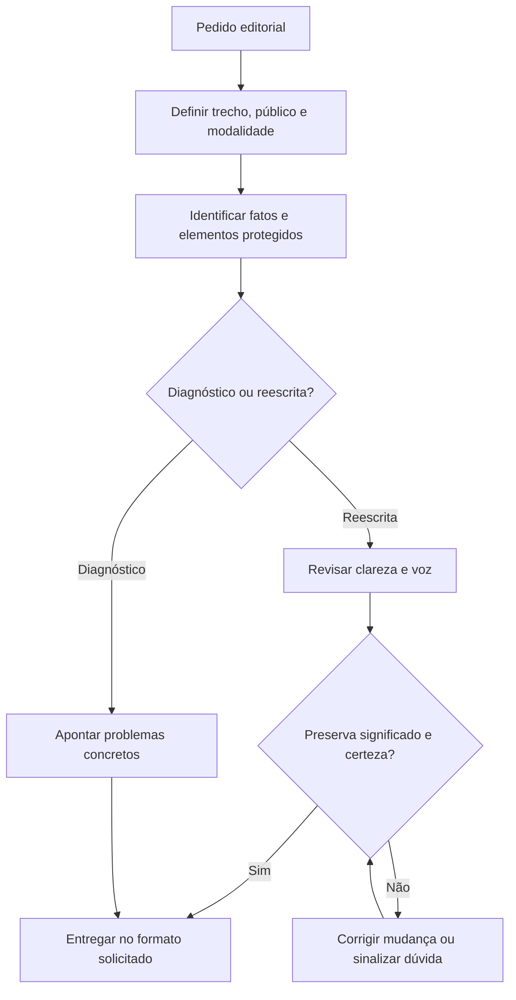

# Auditoria individual: humanizer

Data: 2026-10-22. Estado: proposta para revisão, ainda não aplicada ao pacote ativo.

## Parecer executivo

Manter como micro-skill editorial opcional. Substituir a orientação de antidetecção por um contrato de fidelidade semântica e respeito à voz do autor. Não há necessidade demonstrada de servidor MCP, scripts ou cadeia de sub-skills para esta função.

## Raio-X

O pacote contém apenas `humanizer/SKILL.md`: 93 linhas, 6.729 caracteres Unicode (6.924 bytes UTF-8). Frontmatter: name `humanizer`, licença declarada MIT, metadata.version `3.1.0`. O gatilho descrito combina textos, commits e documentação com voz sênior, burstiness e eliminação de padrões atribuídos a IA. Não há restrição declarativa de ferramentas; o frontmatter não constitui isolamento de permissões.

Não invoca terminal, web, MCP ou outras skills. O trabalho pode ocorrer inteiramente no contexto. Alteração de arquivos depende do pedido ao agente; a referência a commits não deve autorizar operações Git. A writing-pipeline aprovada já a trata como revisão opcional. A release-and-ops ativa ainda exige coordenação editorial; sua proposta anterior permanece pendente e não foi aplicada nesta auditoria.

## Achados

| Prioridade | Evidência | Consequência e proposta |
|---|---|---|
| Alta | Exemplo de cache transforma desempenho/resiliência em carregamento offline após falha de conexão | Introduz capacidade não sustentada. Proibir acréscimo técnico por inferência editorial. |
| Alta | Exemplo de refatoração transforma intenção em modularização concluída e dependências eliminadas | Altera tempo verbal, fatos e resultados. Exigir comparação semântica. |
| Média | Seção de antidetecção usa referências vagas e faixas rígidas de palavras | Retirar promessa e quotas. Literatura histórica não sustenta garantia atual universal. |
| Média | Afirma que modelos sempre escolhem a palavra mais provável | Generalização incorreta: o processo depende da decodificação. Remover teoria desnecessária ao trabalho editorial. |
| Média | Commits sempre minúsculos e sem qualquer menção a IA | Respeitar convenção local, atribuições e declarações exigidas. Preservar BREAKING CHANGE e trailers. |
| Média | Checklist exige voz de engenheiro/cientista no terminal | Apaga registro do autor e inadequado a gêneros distintos. Adaptar ao público. |
| Baixa | Tríades recomendam um, dois ou quatro itens; simetria e travessões tratados como suspeitos | Preservar estruturas funcionais, inclusive listas de três itens e contrastes verdadeiros. |

O risco principal é deriva semântica, não acesso privilegiado. Revisões repetidas para satisfazer métricas artificiais também podem consumir contexto sem melhorar o resultado.

## Pipeline

Fluxo atual inferido das instruções: identificar padrões atribuídos a IA → variar ritmo e estrutura → aplicar regras do gênero → checklist. Não há ramificação explícita entre diagnóstico e edição, nem validação operacional da preservação de sentido.

Fluxo proposto:

O retorno à comparação é limitado a corrigir um problema identificado; não é convite a reescrever indefinidamente. Nenhuma sub-skill é carregada por padrão. Pesquisa e arquitetura documental permanecem sob responsabilidade do fluxo que solicita a revisão.

## Benchmark e alternativas

| Alternativa | Uso adequado | Limite e decisão |
|---|---|---|
| Capacidade editorial nativa do agente | Reescrita curta e contextual | Manter contrato compacto para consistência entre agentes. Sem promessas de ganho de precisão sem avaliação. |
| writing-pipeline do próprio repositório | Estrutura documental, evidências e revisão de documentos maiores | Manter separação; evitar chamada recíproca obrigatória. |
| Vale CLI | Regras editoriais verificáveis e terminologia compartilhada em CI | Opcional onde já houver regras; não valida fatos ou substitui julgamento editorial. |
| Skill humanizer global disponível nesta sessão | Catálogo mais extenso de padrões e algumas proteções semânticas | Comparada por leitura; é pacote distinto. Não copiar integralmente nem substituir apenas por número de versão. |
| MCP dedicado | Acesso a documentos externos quando necessário ao pedido | Sem necessidade para transformar texto já disponível; adicionaria configuração e superfície de acesso. |

O estudo de Liang et al. documenta vieses em detectores avaliados em 2023, especialmente para autores não nativos de inglês. Isso não mede todos os detectores atuais nem textos em português. Sustenta cautela, não uma receita de antidetecção: https://arxiv.org/abs/2304.02819

A especificação Conventional Commits exige a grafia maiúscula de BREAKING CHANGE e admite trailers; minúsculas no título inteiro são preferência local, não regra universal: https://www.conventionalcommits.org/en/v1.0.0/

Vale declara foco em consistência de estilo por regras configuráveis, sem se apresentar como auxílio geral de escrita: https://docs.vale.sh/

## Matriz de refatoração

| Decisão | Elementos | Ganho esperado |
|---|---|---|
| Manter | Concisão, verbos diretos, precisão, remoção de promoção vazia | Preservar utilidade editorial. |
| Substituir | Antidetecção, voz sênior universal e exemplos inventivos | Fidelidade, registro adequado e menos regras conflitantes. |
| Substituir | Regras globais de commits | Convenções do repositório e preservação de metadados. |
| Remover | Quotas de ritmo, assimetria compulsória, blacklist como objetivo, referências acadêmicas vagas | Menor carga instrutiva e menos retrabalho artificial. |
| Não adicionar | MCP, scripts e dependências obrigatórias | Evitar infraestrutura sem necessidade funcional. |

## Proposta e validação

Markdown completo: `docs/audits/proposals/humanizer/SKILL.md`. Mantém a versão declarada para evitar sugerir um release já publicado. O arquivo ativo permanece inalterado até aprovação.

A proposta tem 3.366 caracteres contra 6.729: redução de aproximadamente 50,0%. Caracteres não são tokens; latência, qualidade editorial e consumo real não foram medidos. O validador estrutural quick_validate.py passou.

Revisão manual de invariantes do contrato: intenção não vira resultado; possibilidade não vira garantia; números/unidades/negações permanecem; código e citações são protegidos; três itens reais são aceitos; BREAKING CHANGE e trailers permanecem; diagnóstico não autoriza edição. Isso verifica o desenho das instruções, não demonstra cumprimento por todos os modelos.

A consulta ao grafo existente não encontrou nós de humanizer; conclusões baseadas no arquivo-fonte e nos chamadores inspecionados. Nenhuma instalação global ou operação Git foi executada.

## Consolidação aprovada

Proposta aprovada pelo usuário e aplicada ao pacote ativo. O relatório anterior descreve o estado auditado.
