# Arquitetura atual e proposta

Finalidade: representar contratos observados e decisões propostas. Consumidores: mantenedor, revisores e executores MOD. Diagramas atuais derivam de catálogo, scripts e SKILL.md na base 869444d; setas entre skills representam encaminhamento instrucional, não execução automática. O grafo ignorado de 2026-10-22 não representa essa base.

## Atual 1 — Componentes

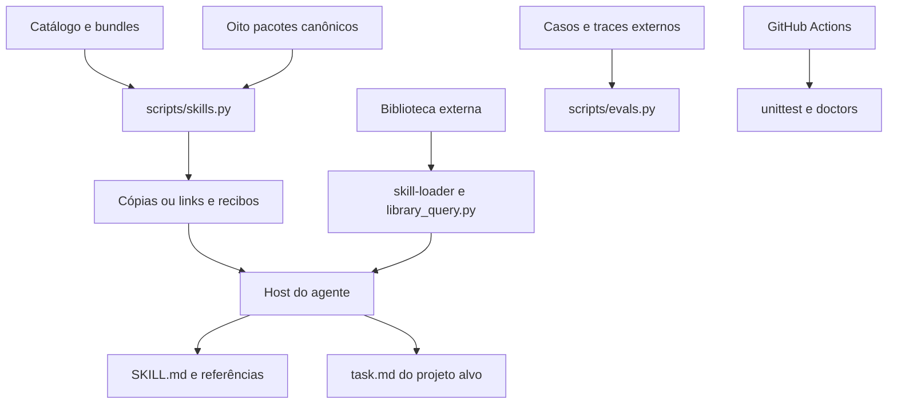

## Atual 2 — Dependências entre skills

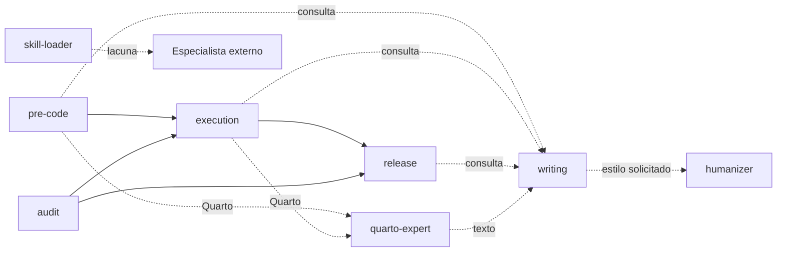

## Atual 3 — Descoberta e ativação

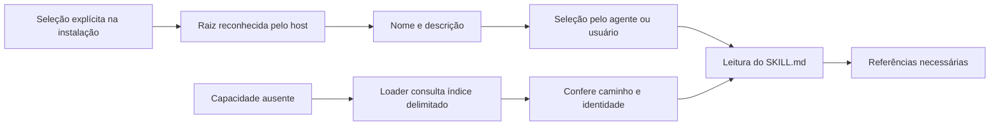

## Atual 4 — Fluxo de execução

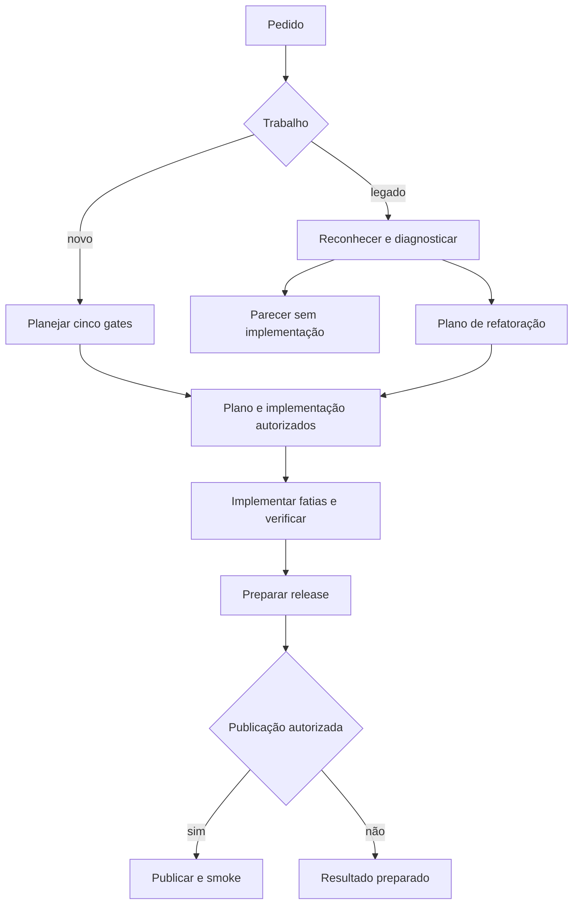

## Atual 5 — Handoffs e gates

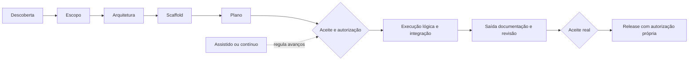

## Atual 6 — Distribuição multiagente

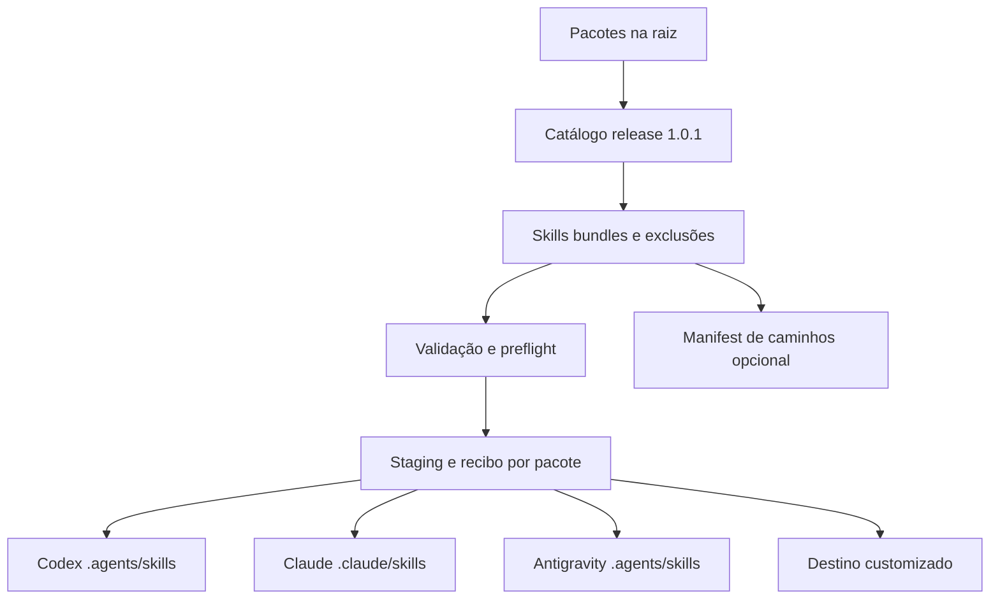

## Atual 7 — Persistência e retomada

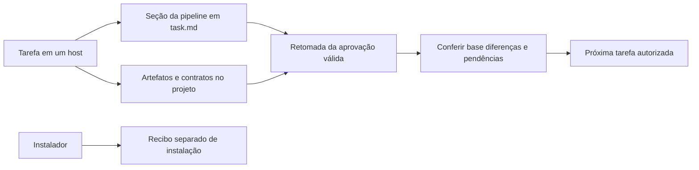

## Proposta 1 — Componentes futuros

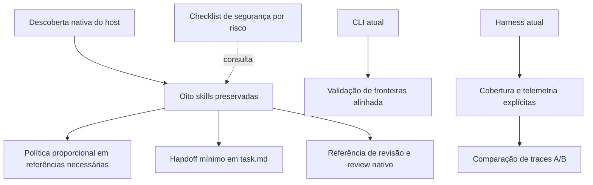

## Proposta 2 — Desenvolvimento

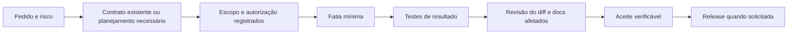

## Proposta 3 — Auditoria e refatoração

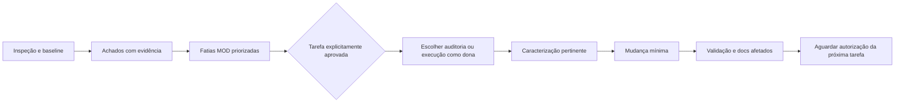

## Proposta 4 — Revisão de PR

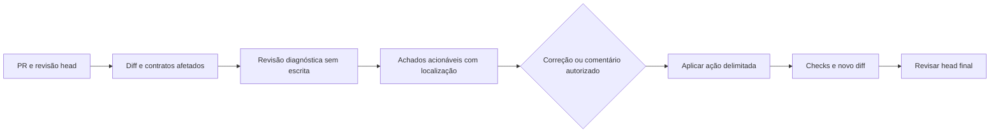

## Proposta 5 — Avaliação A/B

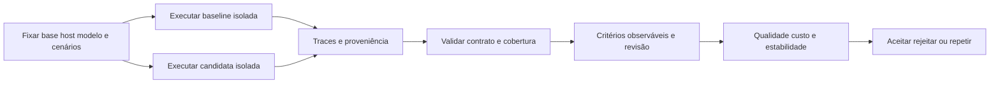

## Proposta 6 — Carregamento seletivo

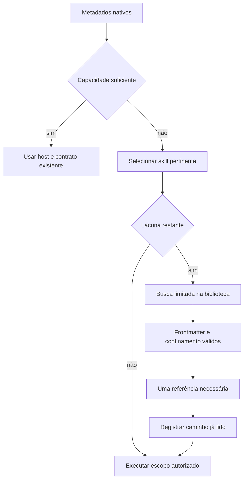

## Proposta 7 — Código, contratos, docs e testes

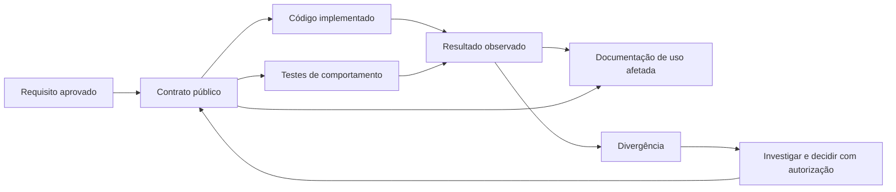

## Comparação e trade-offs

| Aspecto | Atual | Proposto | Custo e alternativa descartada |
|---|---|---|---|
| Roteamento | Metadados e critérios de cada skill | Casos negativos/discriminantes e limites refinados por evidência | Mais avaliações; descartar roteador central sem lacuna medida |
| Gates | Cinco gates em pipelines; contratos documentais nomeados | Mesmos controles com evidência proporcional por referência | Exige mudar contrato sob aprovação; não apagar rastreabilidade |
| Handoff | Instrucional e task.md | Campos mínimos, base/autoridade e dono da fatia | Pequena disciplina; descartar banco/framework de estado |
| Documentação | Fontes + propostas/histórico | Propriedade e precedência explícitas | Preservar cópias históricas, não deduplicar por exclusão |
| Revisão | Gate 5 e capacidades do host | Referência e modo diagnóstico por escopo | Pode faltar interface uniforme entre hosts; testar antes de nova skill |
| Avaliações | Classificador de traces fornecidos | Contratos robustos, cobertura e métricas observadas | Captura externa continua necessária; não prometer execução automática |
| Segurança | Limites instrucionais, filesystem e CI | Validar entradas e checklist por risco | Sandbox real continua do host; checklist não certifica segurança |
| Distribuição | Cópia/link com recibo | Preservar; hardening de CI e falhas por pacote | SHAs exigem manutenção; transação global adiada sem necessidade comprovada |
