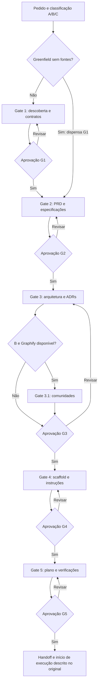

# Auditoria individual: pre-code-pipeline

Data: 2026-10-22. Escopo: Fase 1, primeira meta-skill. Proposta para revisão, sem aplicação ao SKILL.md vigente. As demais meta-skills foram consultadas apenas como contratos de integração, sem auditoria individual.

Atualização após aprovação do usuário: a proposta foi consolidada em `pre-code-pipeline/SKILL.md` no repositório. A descrição da análise e das verificações abaixo registra o estado anterior à aprovação; não foram sincronizados perfis globais de agentes. A política geral do README será harmonizada na Fase 2.

## Parecer

Manter os cinco gates, aprovação humana e contratos persistentes. Refatorar o núcleo para reduzir dependências de outros orquestradores, corrigir transições e separar orientação especializada de capacidade executável. Não há fundamento para declarar todas as dependências obsoletas: os problemas demonstrados são sobreposição, incompatibilidade de contrato, indisponibilidade local e inadequação ao gate.

## 1. Raio-X

- Nome: `pre-code-pipeline`; título interno v2.1.
- Frontmatter: `name` e `description`; descrição cita planejamento, DDD/Clean Architecture/TDD e CRISP-ML(Q)/Data Storytelling. Não há campo `trigger` separado.
- Ativação declarada: pedir a skill, arquétipo, caminho e Gate 1 ou 2. A descoberta automática depende da descrição e do host; a frase de ativação no corpo só aparece depois do carregamento.
- Responsabilidade: descoberta → requisitos → arquitetura → scaffold → plano. Handoff para execution-pipeline.
- Privilégio efetivo: herdado do host, sandbox e credenciais. A skill não define ACL nem cria isolamento próprio. Não há MCP declarado ou configurado neste pacote.

| Superfície | Uso atual | Limite necessário |
|---|---|---|
| Filesystem | Ler fontes; escrever docs, task.md, configuração e scaffold | Preservar dados e arquivos existentes; distinguir configuração de implementação |
| Terminal | Profiling, scaffold, Graphify | Conhecer efeitos do gerador; evitar código de aplicação e instalações implícitas |
| Web | Possível por ideação e consultas delegadas | Fontes verificáveis, escopo de pesquisa limitado |
| Banco/cloud/MCP | Indireto por skills de descoberta e arquitetura | Identidade e permissões reais; leitura limitada, sem migrações |
| Configuração do agente | agy-customizations e agents-generator | Não modificar perfil global como efeito colateral do planejamento |

`risk: critical` encontrado em dependências é metadado de sua biblioteca, não uma prova de elevação de privilégio. Da mesma forma, uma instrução textual de leitura não torna uma conta SQL read-only.

## 2. Fluxo atual

### Inventário de orquestração

34 nomes distintos nos blocos de skills mobilizadas dos Gates 1–5. Contagem exclui `skill-loader` como infraestrutura, `execution-pipeline` como destino e ferramentas como uv/pytest/pnpm. Há 30 entradas localizadas: 28 externas e duas pertencentes ao repositório. Localização não significa instalação completa ou comportamento validado; os conteúdos relevantes às sobreposições foram inspecionados. Não houve execução dessas dependências.

| Gate | Dependências citadas |
|---|---|
| 1 | planning-with-files; data-scientist; schema-mapping; data-autocleaning; data-quality-frameworks; discovering-gcp-data-assets |
| 2 | planning-with-files; brainstorming; data-storytelling; idea-os; spec-driven-development; ask-questions-if-underspecified; saas-mvp-launcher; writing-pipeline |
| 3 | planning-with-files; software-architecture; architecture-decision-records; writing-pipeline; mermaid-expert; data-scientist; data-storytelling; quarto-expert; domain-driven-design; senior-architect; architecture-patterns; database-architect; database-design; architect-review; api-design-principles; c4-architecture-c4-architecture |
| 4 | planning-with-files; agy-customizations; quarto-expert; python-development-python-scaffold; javascript-typescript-typescript-scaffold; agents-generator |
| 5 | planning-with-files; writing-plans; tdd-workflow; planning-and-task-breakdown; writing-pipeline; spec-driven-loop; webapp-testing |

Ausentes nas duas pastas locais consultadas e no texto do índice da biblioteca fria: `schema-mapping`, `data-autocleaning`, `discovering-gcp-data-assets`, `agy-customizations`. Isso não prova inexistência upstream.

### Achados

| ID | Gravidade | Evidência e consequência | Recomendação |
|---|---|---|---|
| PC-01 | Alta | Caminhos absolutos em regras e referências apontam ao perfil Gemini de um usuário. Copiar para Claude/Codex mantém esse acoplamento. | Referências internas relativas à raiz da skill; descoberta do host para skills externas. |
| PC-02 | Alta | A meta-skill exige task.md; planning-with-files exige task_plan.md, findings.md e progress.md, além de atualizações a cada duas leituras. | Um único contrato de estado; dispensar o orquestrador aninhado. |
| PC-03 | Alta | idea-os, spec-driven-development e spec-driven-loop introduzem fluxos próprios; writing-plans usa docs/plans e encaminha para superpowers:executing-plans. | Manter um controlador dos gates; extrair apenas critérios úteis de conhecimento. |
| PC-04 | Alta | G1 pode ser pulado, mas handoff manda marcar todos os gates como aprovados. | Registrar dispensado com justificativa e confirmação, sem fabricar aprovação. |
| PC-05 | Alta | G3.1 chama comunidade mista de violação verificada; não exige regra arquitetural nem inspeção das dependências. | Tratar agrupamento como hipótese. Conferir arestas, direção, código e regra violada. |
| PC-06 | Alta | Proibição de implementação conflita com geradores de G4; scaffolds locais contêm exemplos FastAPI e TS de aplicação. | Declarar allowlist de saídas; adiar geração de aplicação e instalação. |
| PC-07 | Média | Quatro dependências citadas não foram localizadas; não há contrato uniforme de indisponibilidade. | Núcleo autocontido; bloquear só uma decisão realmente dependente. |
| PC-08 | Média | C4 local exige análise bottom-up de código e agentes específicos por diretório. Inadequado ao greenfield sem código e potencialmente custoso. | Diagramas de contexto/container sob demanda, sem crawler obrigatório. |
| PC-09 | Média | Gate de descoberta já pressupõe target e leakage; checklist impõe modelagem, pt-BR e GitHub Pages a todo A. | Distinguir analytics, ML e pesquisa; tornar idioma e destino escolhas do projeto. |
| PC-10 | Média | Gate 5 pede comandos exatos sem estados de evidência; handoff assume disponibilidade de execution-pipeline. | Distinguir planejado/executado e pronto para execução/execução autorizada. |
| PC-11 | Média | Releitura editorial mobiliza humanizer e referências métricas mesmo para contratos curtos; arquitetura mobiliza vários generalistas. | Especialistas por lacuna; revisão editorial aprofundada apenas quando útil. |
| PC-12 | Média | Não há política local de custo de profiling remoto, agregação ou minimização de dados nos artefatos. | Consultas delimitadas e identidade read-only; registrar cobertura e limitações. |

G1 antes de G2 pode ser adequado quando contratos existentes determinam a viabilidade, mas exige uma pergunta de negócio preliminar para evitar exploração sem objetivo. Os cinco gates são planejamento; não equivalem à execução das seis fases CRISP-ML(Q). G5 prepara Act, não realiza deploy.

## 3. Benchmarking arquitetural

Esta comparação é documental e estrutural, não um benchmark de latência ou qualidade do modelo.

| Opção | Adequação | Decisão |
|---|---|---|
| Agent Skills aberto | name/description, referências e scripts sob demanda | Adotar como núcleo portátil; paths de recursos relativos à skill |
| Codex nativo | Descoberta de skill e leitura progressiva do conteúdo | Usar descoberta do host, sem loader preso ao Gemini |
| Claude Code nativo | Skills e controles de invocação/permissão específicos | Manter extensões do host fora do núcleo portátil; allowed-tools não é uma ACL portátil de leitura |
| Antigravity nativo | Descoberta por descrição, skill global ou de workspace e carregamento progressivo | Remover dependência de view_file como nome universal de ferramenta |
| GitHub Spec Kit | Processo estruturado com templates, especificação, plano e tarefas | Alternativa de controlador completo; não empilhar sob cinco gates próprios |
| uv init --bare | Inicialização mínima de configuração Python | Candidato de G4; conferir versão e saídas, sem executar uv init comum cegamente |
| MCP Toolbox for Databases | Ferramentas configuráveis para metadados/SQL e toolsets read-only | Opcional para fonte remota; credenciais read-only e catálogo mínimo, não substitui contrato de qualidade |
| CLI de banco e leitor local | Inspeção sem servidor adicional | Preferência quando já disponíveis e suficientes; MCP não melhora sozinho raciocínio ou custo |

MCP fornece acesso e ações; skill fornece procedimento. Prompts MCP podem oferecer modelos de instrução, recursos podem fornecer schemas e ferramentas podem consultar fontes. Nenhuma dessas primitivas executa por si só os cinco gates. Não se propõe servidor MCP próprio para gerar PRD ou atualizar um Markdown local.

## 4. Matriz de substituição

Remover significa retirar do carregamento obrigatório desta meta-skill; não desinstalar ou apagar a biblioteca.

| Ação | Elementos atuais | Destino e ganho esperado |
|---|---|---|
| Manter | Cinco gates, artefatos docs/00–05, aprovação humana, non-goals, critérios verificáveis | Contrato comum e rastreabilidade entre pipelines |
| Manter condicional | quarto-expert e checklist Quarto | Especialização de formato sem carregar todas as modalidades |
| Manter condicional | data-scientist, data-quality-frameworks, data-storytelling | Uma necessidade analítica concreta; distinguir inspeção, contrato e narrativa |
| Manter condicional | domain-driven-design; api-design-principles; database-design | Domínio complexo, API real ou decisão de persistência; evitar DDD em CRUD simples |
| Substituir | planning-with-files | task.md com estados, decisões e evidências; evita três arquivos e releituras conflitantes |
| Substituir | brainstorming, idea-os, spec-driven-development, ask-questions-if-underspecified | G2 autocontido com perguntas decisivas e critérios de aceite; evita múltiplos funis de aprovação |
| Substituir | writing-plans, planning-and-task-breakdown, spec-driven-loop | G5 único com tarefas, dependências e verificação; preserva docs/05 e handoff correto |
| Substituir | software-architecture, senior-architect, architecture-patterns, architect-review | G3 com decisões proporcionais; especialista único quando necessário |
| Substituir | database-architect quando usado junto de database-design | Uma orientação de banco; acesso factual por CLI/MCP somente se necessário |
| Substituir | architecture-decision-records | Template curto de contexto, decisão, alternativas e consequências; biblioteca completa para decisões complexas |
| Substituir | python-development-python-scaffold; javascript-typescript-typescript-scaffold | Configuração mínima revisada e gerador oficial apropriado; adiar os que implementam aplicação |
| Substituir | schema-mapping; data-autocleaning; discovering-gcp-data-assets | Contrato autocontido de descoberta e leitor local ou conector da fonte; ausência de skill não impede núcleo |
| Remover do padrão | agy-customizations; skill-loader | Detecção/descoberta do host; eliminação de dependência do perfil pessoal |
| Remover do padrão | c4-architecture-c4-architecture; mermaid-expert | Diagrama suficiente produzido diretamente; usar especialista só para dificuldade real |
| Remover do padrão | agents-generator | Instruções curtas e específicas no arquivo reconhecido pelo host; evitar varredura e regeneração desnecessárias |
| Remover do padrão | saas-mvp-launcher | Produto SaaS somente quando parte do escopo; não forçar autenticação/pagamentos |
| Remover do planejamento | webapp-testing; carga completa de tdd-workflow | Planejar verificação no G5; executar testes na pipeline de execução |
| Reduzir acionamento | writing-pipeline e sua cadeia humanizer | Prosa contratual direta; revisão editorial aprofundada quando necessária, não a cada documento curto |
| Manter opcional com correção | Graphify | Só código/grafo útil; cobertura e atualidade explícitas; sem inferência automática de violação |

## 5. Proposta e compatibilidade

A proposta está em `pre-code-pipeline/SKILL.proposed.md`; deve substituir SKILL.md apenas após revisão. Não foi instalada. Preserva nomes de artefatos e campos de docs/00 usados pela execution-pipeline; adiciona estado dispensado em task.md para corrigir a falsa aprovação.

Não contém frontmatter proprietário, dependência de uma ferramenta chamada view_file, caminho /home/tales ou requisito de MCP. A checklist existente continua ao lado da skill. Ela é interpretada pelo tipo de projeto, com adaptações registradas; sua própria refatoração não está sendo aplicada nesta rodada.

Adotar referências relativas contradiz a regra atual do README, seção 6.3. Trata-se de mudança proposta, alinhada ao objetivo multiambiente e à especificação Agent Skills, não de uma migração aplicada silenciosamente. A revisão dessa política e o instalador ficam para a Fase 2.

## 6. Verificação e critérios para aceite

Verificações estáticas: frontmatter YAML, nome, description, referência local, preservação dos caminhos de saída e revisão do diff. O quick_validate.py da skill-creator retornou `Skill is valid!` em uma cópia temporária com o nome SKILL.md e sua referência. `git diff --exit-code -- pre-code-pipeline/SKILL.md` confirmou que a skill vigente permanece intacta. Proposta não executada como pipeline. Não houve instalação de MCP, mudança global ou início de implementação.

Métrica reproduzida por leitura dos dois arquivos: original com 204 linhas e 15.184 caracteres; proposta com 74 linhas e 8.227 caracteres, redução de 45,8% em caracteres. Linhas longas concentram parte das instruções; a comparação relevante de contexto exige o tokenizer do modelo e o conjunto de dependências realmente carregadas. As 30 entradas localizadas somam 222.021 caracteres apenas em seus SKILL.md, antes de referências e dependências transitivas; esse total é superfície potencial, não carga observada em uma execução.

Antes de promover a proposta, executar os mesmos casos no original e na proposta, em ambientes isolados e com o mesmo modelo e permissões:

| Caso | Comportamento esperado |
|---|---|
| Greenfield CLI sem dados | Confirma C, dispensa G1 com registro, aprova G2 antes de G3 |
| Analytics sem ML | Não inventa target, modelo ou validação preditiva |
| ML com dados temporais | Contrato de instante da previsão e risco de leakage |
| API com domínio simples | Contratos proporcionais; sem DDD/C4 completo obrigatório |
| Skill ou MCP ausente | Núcleo continua; apenas decisão indispensável fica pendente |
| Comunidade mista no grafo | Não declara violação sem regra e evidência no código |
| Scaffold gera aplicação | Adia gerador e não cria regras de negócio no pré-código |
| Retomada após feedback | Recupera estado e reabre só contratos invalidados |
| Aprovação de plano sem autorização de implementar | Entrega handoff e aguarda pedido de execução |

Medir tokens totais por caso, leituras de arquivos, chamadas de ferramentas, tempo, pedidos de confirmação redundantes e cumprimento dos contratos. Não converter redução de caracteres em promessa de redução percentual de latência ou tokens finais. O objetivo é reduzir sobreposição preservando acerto e governança.

## Fontes oficiais consultadas

- [Agent Skills: especificação](https://agentskills.io/specification): frontmatter, divulgação progressiva e referências relativas.
- [OpenAI: criação de skills](https://learn.chatgpt.com/docs/build-skills): descoberta e corpo carregado sob demanda.
- [Claude Code: skills](https://code.claude.com/docs/en/skills): extensões de frontmatter, ciclo de contexto e permissões.
- [Antigravity: skills](https://antigravity.google/docs/skills/): descoberta e carregamento progressivo.
- [MCP: conceitos de servidor](https://modelcontextprotocol.io/docs/2026-07-28/learn/server-concepts): recursos, prompts e ferramentas.
- [GitHub Spec Kit](https://github.com/github/spec-kit): processos, templates e integração com agentes.
- [uv: inicialização de projetos](https://docs.astral.sh/uv/concepts/projects/init/): opção bare.
- [MCP Toolbox for Databases](https://googleapis.github.io/mcp-toolbox/) e [modo read-only](https://mcp-toolbox.dev/documentation/configuration/security/read-only/): acesso a fontes e redução de catálogo de ferramentas.
