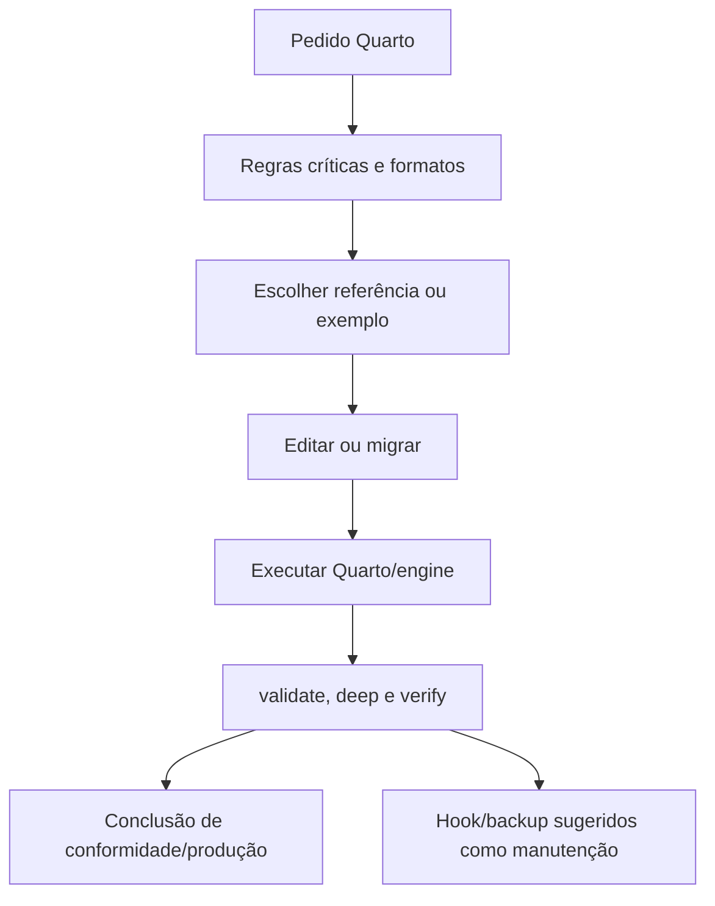

# Auditoria individual: quarto-expert

Data: 2026-10-22. Extensão da Fase 1 às três skills complementares, começando por quarto-expert. Humanizer e skill-loader ainda aguardam auditoria individual. Release-and-ops permanece como proposta não consolidada, sem aceite adicional do usuário. Fase 2 adiada. Pacote Quarto vigente intacto; proposta em `docs/audits/proposals/quarto-expert/`.

## Parecer

Manter a especialista e o acervo de autoria/migração. Refatorar o núcleo para seleção por tarefa, versão e formato, corrigir contradições verificadas e substituir a manutenção presa ao perfil Gemini por um doctor do pacote real. Uma skill de domínio é útil aqui; não há benefício em reescrever toda a documentação oficial ou instalar MCP para render local.

## 1. Raio-X

- Frontmatter name/description: autoria, configuração, depuração e migração Quarto; menciona formatos e Python/R. Não há trigger separado.
- Escopo: metadados, engines, cache, células, referências, layout, fontes, extensões, templates, compilação e migração.
- Estrutura original: 54 arquivos versionados, núcleo com 310 linhas, 27 referências, 3 suítes de exemplos e 7 scripts/hooks. As 27 referências somam 135.276 caracteres; só são custo de contexto quando carregadas, não por mera presença em disco.
- Sub-skills: nenhum orquestrador externo obrigatório de implementação; as cinco pipelines são chamadoras, não dependências a executar. Graphify é guia compartilhado/passivo. Quarto, Pandoc, Python, R, Jupyter, LaTeX/Typst, browser e extensões são capacidades/runtimes, não sub-skills.
- Privilégios: os do host e credenciais. Render pode executar código/filtros e scripts; gerenciamento de extensões pode baixar código. Hooks e backup atuam fora do documento e precisam de fronteira própria.

| Superfície | Uso atual | Limite recomendado |
|---|---|---|
| Filesystem | Editar QMD/YAML, gerar outputs/cache, copiar exemplos | Preservar fonte e mudanças existentes; destino explícito |
| Terminal | Quarto/check/render, scripts Bash, R/Python | Engine/versão reais e execução proporcional |
| Rede | Templates, extensões, fontes/pacotes e Binder | Origem/revisão e efeito conhecidos; sem instalação implícita |
| Git/hooks | Instalar hook no perfil .gemini/config | Não substituir hooks/configuração global automaticamente |
| Backup | Copiar exemplos e remover backups antigos | Retenção explícita, fora do núcleo de autoria |
| MCP | Nenhum declarado | Opcional para recuperar fonte autorizada, não render local obrigatório |

## 2. Fluxo descrito e fluxo necessário

O núcleo atual apresenta regras e catálogo, mas não um protocolo único de entrada, escolha e verificação. A sequência prática inferida é:



A proposta explicita a sequência: identificar alvo/formato/versão → inspecionar configuração/efeitos → ler referência pertinente → editar → executar check/render necessário → inspecionar output → relatar evidência e limitações. Manutenção do pacote e validação do documento são operações separadas; compilação não autoriza publicação nem conformidade normativa.

### Inventário das referências

| Grupo | Recursos |
|---|---|
| Configuração/execução | yaml-front-matter, engines, code-cells, brand-yml |
| Autoria | cross-references, citations, figures, tables, callouts, diagrams, divs-and-spans, layout, shortcodes, conditional-content, alt-text, markdown-linting |
| Migração | conversion-rmarkdown, conversion-jupyter, conversion-bookdown, conversion-blogdown, conversion-distill, conversion-xaringan, rmd-to-quarto-migration |
| Formatos/templates | abnt-thesis-guide, typst-and-templates, extensions |
| Integração transversal | graphify-integration |

Não foi feita certificação independente de toda instrução das 27 referências. Houve inventário completo e leitura dirigida dos pontos de conflito, automação e exemplos. A proposta preserva o acervo, com correções focalizadas; trechos sensíveis à versão continuam sujeitos à documentação e à configuração efetiva.

### Achados priorizados

| ID | Gravidade | Evidência e consequência | Correção |
|---|---|---|---|
| Q-01 | Alta | Validadores apontam para /home/tales/.gemini/config/skills/quarto-expert, não o checkout passado pelo usuário. | Root explícito ou derivado do script; não aprovar uma cópia diferente. |
| Q-02 | Alta | Hook filtra skills/quarto-expert/, mas este repo usa quarto-expert/. Fixture retornou 0 sem chamar validator. | Detecção de layout/caminhos pelo instalador, sem sucesso silencioso. |
| Q-03 | Alta | install_hooks fixa outro repositório e substitui symlink; .git como diretório não cobre todos os worktrees. | Tirar instalação automática do núcleo; preservar hooks e respeitar core.hooksPath/layout. |
| Q-04 | Alta | Deep pula render offline/skip-render/exemplo ausente, mas conclui apta para produção. | Estados distintos: check executado, pulado e falhou, com limitação explícita. |
| Q-05 | Alta | verify --json emite exit_code 0 quando há só WARN; processo sai 2. | JSON e exit processual coerentes e definidos. |
| Q-06 | Alta | Manuscrito mostra AUC=0.87 fixa em curva sintética cuja área trapezoidal é aproximadamente 0.585465. | Identificar exemplo sintético e calcular a métrica exibida. |
| Q-07 | Média | Núcleo/code-cells diferenciam cache Jupyter, mas engines afirma cache por célula para ambos e ausência de inline Jupyter. | Uma referência de engine corrigida e documentação de versão. |
| Q-08 | Média | format do QMD é descrito como substituição integral de toda configuração. | Distinguir lista de formatos de opções herdadas; confirmar via inspect. |
| Q-09 | Média | _brand.yml atribuído a Quarto 1.5+; documentação descreve suporte 1.6 e precedência de tema. | Verificar suporte efetivo e interação brand/theme. |
| Q-10 | Média | init_quarto_project recebe PROJECT_TYPE, mas não usa para gerar configuração/projeto; só cria diretórios/ignore. | Usar criação nativa ou scaffold verificável; não chamar diretórios de projeto completo. |
| Q-11 | Média | Backup usa perfil fixo e remove cópias automaticamente pela retenção; instalação muda hooks. | Separar operação de autoria e manutenção com alvo/efeitos explícitos. |
| Q-12 | Média | Snapshot YAML apenas sintático e seções por grep podem passar em comentários; verify lista só parte das referências. | Validar contrato/links do pacote, sem inferir qualidade por headings. |
| Q-13 | Média | Token header é len/4, não tokenização do host; scripts assumem Bash/utilitários e interpreters pessoais. | Relatar medidas honestas e usar ferramenta portátil sem instalação automática. |
| Q-14 | Média | Typst é vendido como instantâneo e sem dependências; ABNT/PDF-A como consequência de template. | Separar motor, recursos, requisitos normativos e validação do output. |
| Q-15 | Média | Exemplo de tese é esqueleto sem todos os elementos institucionais; exemplo mínimo não tem fig-alt. | Rotular limite do starter e corrigir acessibilidade do exemplo. |
| Q-16 | Média | Manifests do exemplo Binder não têm lock; render HTML mínimo não valida book, PDF, R ou manuscript. | Matriz de testes por formato/engine com cobertura explicitada. |
| Q-17 | Média | Instrução universal de ordem de atributos/sintaxe pode confundir convenção editorial com requisito do parser. | Validar caso mínimo e distinguir estilo recomendado de sintaxe indispensável. |
| Q-18 | Média | Muitas regras repetem manuais e acoplam runtime/layout/caminhos pessoais. | Núcleo roteador e recursos sob demanda; docs oficiais para detalhes voláteis. |
| Q-19 | Média | Graphify compartilhado contém catálogo de versão anterior e não é uma dependência Quarto. | Manter passivo, sem carregar em autoria comum; revisar na tarefa de grafo. |

ABNT e PDF/A não foram certificados nesta auditoria: não houve acesso/validação integral de normas, manual institucional ou output final. O achado é a promessa excessiva, não uma lista normativa alternativa inventada.

### Provas e limites

1. **Configuração efetiva:** fixture em /tmp com projeto HTML(toc=true, theme=cosmo)+DOCX e documento HTML(code-fold=true). Quarto 1.10.19 inspect produziu somente HTML, preservando toc=true e theme=cosmo, adicionando code-fold=true. Confirma seleção da lista, não remoção de todas as opções do formato.
2. **Hook:** repositório Git temporário, arquivo staged quarto-expert/SKILL.md e validator fixture que escreveria marcador/falharia. Hook original retornou 0, sem output e sem marcador. Não houve instalação de hook ou commit real.
3. **Métrica:** área trapezoidal da curva do exemplo calculada com biblioteca padrão: aproximadamente 0.585465239, diferente do rótulo 0.87. Não é avaliação de modelo real.
4. **Bash/YAML:** sete scripts/hooks passam bash -n; três configs YAML são carregadas por PyYAML. Isso não comprova seus efeitos, schema Quarto ou renders.

## 3. Comparação de alternativas

| Capacidade | Alternativa | Ganho e limite |
|---|---|---|
| Configuração/diagnóstico | Quarto CLI, inspect e check | Evidência do runtime e metadados; check não prova output final |
| Scaffold | Comando nativo de criação compatível com versão/template revisado | Evita script que só cria diretórios; gerador ainda precisa de revisão de efeitos |
| Autoria/migração | Referências Posit/Quarto já adotadas e docs oficiais pontuais | Preservar acervo sem duplicar nova skill completa em cada tarefa |
| Runtime/render | Ambiente do projeto e engine configurado | Evita escolher Miniforge global e falsos requisitos de R/Python |
| QA do pacote | doctor.py portátil e root explícito | Checks repetíveis e estados coerentes, sem hook/backup implícito |
| PDF e norma | Motor/template adequado + inspeção e validador específico quando requerido | Build e conformidade são evidências diferentes |
| Evidências externas | Fonte primária ou conector autorizado | Não há justificativa para um MCP de render quando CLI local atende |

A documentação oficial confirma que format do documento define sua lista completa de formatos; opções podem continuar herdadas. Quarto documenta cache Jupyter em escopo de notebook e inline Python. Extensões ficam junto ao projeto, mas podem conter filtros/código; a instalação não é mera leitura de documento.

## 4. Matriz de refatoração

| Decisão | Elementos | Destino |
|---|---|---|
| Manter | Especialista Quarto e biblioteca de 27 referências | Consulta por tarefa, sem carregar toda a biblioteca |
| Manter | Três exemplos | Starters com limites claros e dados sintéticos identificados |
| Manter condicional | Typst, ABNT, migrações, identidade e acessibilidade | Requisito real e versão/formato observados |
| Substituir | Núcleo de regras absolutas e catálogo repetido | Roteamento + fluxo de diagnóstico/edição/verificação |
| Substituir | validate/deep/verify presos ao perfil | doctor.py com root, estados e códigos coerentes |
| Substituir | Inicialização própria incompleta | Comando nativo/template revisado no projeto alvo |
| Remover do padrão | Instalação de hooks e rotação de backups | Operação explícita de ambiente, fora da autoria |
| Corrigir | Cache/inline/metadata contraditórios | Referência de engine e checagem efetiva |
| Corrigir | AUC e promessas de conformidade | Métrica calculada e exemplo não certificado |
| Retirar como dependência | Graphify durante autoria comum | Referência transversal passiva |

Não se remove silenciosamente a biblioteca vigente. A proposta preserva referências e exemplos em pacote isolado e altera apenas os guias conflitantes e exemplos identificados. Os sete scripts antigos não integram o novo pacote proposto; sua substituição só ocorrerá após aceite, com preservação histórica antes da consolidação. A Fase 2 terá instalação/doctor geral; este doctor cobre somente Quarto e não instala skills nem configura agentes.

## 5. Proposta concreta

```
quarto-expert/
├── SKILL.md
├── references/                 27 guias, correções dirigidas
├── examples/                   3 starters revisados
└── scripts/doctor.py            checks estáticos e smoke HTML opcional
```

Doctor padrão não executa Quarto, hooks, código de notebook ou instalação. --runtime consulta versão. --render-smoke cria HTML estático sem código em diretório temporário e não testa o documento do usuário. --quarto permite executável explícito, sem fixar /opt ou perfil do usuário. Saída JSON tem o mesmo exit_code do processo: 0 passou, 1 falhou, 2 check não executado sem outra falha. PyYAML ausente não resulta em YAML aprovado.

Links no núcleo são validados; esse checker usa regex delimitada para os links controlados do próprio manifesto, não se apresenta como parser genérico de todos os exemplos de Markdown. As referências extensas continuam passíveis de drift; conferir uma opção no manual não certifica todo o acervo.

## 6. Validação e avaliação pendente

O quick_validate.py passou para o pacote proposto; o doctor estático registrou 34 checks aprovados. Foram exercitados os casos PyYAML ausente (exit 2), Quarto ausente solicitado (exit 1) e referência quebrada (exit 1), com coerência entre JSON e código do processo. Sintaxe do doctor e das células Python dos exemplos foi conferida. `git diff --check` passou; `git diff --exit-code -- quarto-expert release-and-ops-pipeline` confirmou ambos os pacotes vigentes intactos.

O primeiro smoke HTML falhou por impossibilidade de abrir o cache Quarto sob a restrição de filesystem. Após autorização explícita para acesso ao cache local, a mesma fixture temporária renderizou com Quarto 1.10.19, retornando `render_static_html: pass` e exit 0. Isso verifica somente HTML estático, não R/Python, tese, PDF, ABNT, Binder ou templates computacionais. Nenhum hook do usuário, perfil global, aplicação ou publicação foi alterado.

| Medida | Original | Proposta | Redução |
|---|---:|---:|---:|
| Núcleo, caracteres | 16.464 | 6.857 | 58,4% |
| Núcleo, linhas | 310 | 58 | — |
| Arquivos Markdown do pacote, caracteres | 152.548 | 135.979 | 10,9% |
| Referências preservadas | 27 | 27 | — |

Contagens Unicode, não tokens. A medida de Markdown exclui scripts/configurações e não equivale ao footprint total do pacote ou ao custo por tarefa. O novo doctor e a maior parte da biblioteca não devem ser carregados como instrução de autoria. Não houve benchmark de latência/qualidade de agentes.

| Caso | Aceite esperado |
|---|---|
| Instalação em outro diretório | Doctor lê a raiz real, sem acesso ao perfil Gemini |
| PyYAML ausente | JSON e processo informam check não executado, exit 2 |
| Recurso obrigatório ausente | Falha real, exit 1 |
| Quarto indisponível no modo runtime | Falha sem instalação automática |
| Smoke HTML | Render da fixture confirma somente HTML estático |
| Engine Python/R ausente | Não certificar render computacional ou exigir motor irrelevante |
| Perfil/format override | Configuração efetiva preserva opções herdadas pertinentes |
| Mudança em dados externos com freeze | Não presumir freshness do output |
| Tese inicial | Não prometer conformidade integral sem requisito/inspeção |
| Migração real | Comparar referências, execução, assets e resultados no destino |
| Hooks preexistentes | Não instalar/substituir como efeito de autoria |

Antes de generalizar a compatibilidade, testar engines/formatos efetivamente suportados no CI e inspecionar outputs. Não converter redução de caracteres em promessa de latência ou tokens.

## Fontes oficiais

- [Quarto Project Basics](https://quarto.org/docs/projects/quarto-projects.html): herança e lista de formatos.
- [Quarto inspect](https://quarto.org/docs/cli/inspect.html): configuração efetiva.
- [Caching](https://quarto.org/docs/computations/caching.html) e [inline code](https://quarto.org/docs/computations/inline-code.html): escopos de engine.
- [Brand](https://quarto.org/docs/authoring/brand.html): suporte e precedência de temas.
- [Typst](https://quarto.org/docs/output-formats/typst.html), [PDF](https://quarto.org/docs/output-formats/pdf-basics.html) e [diagrams](https://quarto.org/docs/authoring/diagrams.html): capacidades e dependências por destino.
- [Extensions](https://quarto.org/docs/extensions/managing.html): instalação local ao projeto.
- [Posit skills](https://github.com/posit-dev/skills): autoria especializada upstream.
- [danielvartan/abnt](https://github.com/danielvartan/abnt): formato candidato, não certificação do exemplo local.


## Consolidação aprovada

Proposta aprovada pelo usuário e aplicada ao pacote ativo. Os sete scripts e hook anteriores foram preservados em `docs/audits/legacy/quarto-expert/scripts/`; o pacote passa a usar `scripts/doctor.py`. Referências e exemplos foram sincronizados com a proposta. A análise acima documenta o estado anterior.
