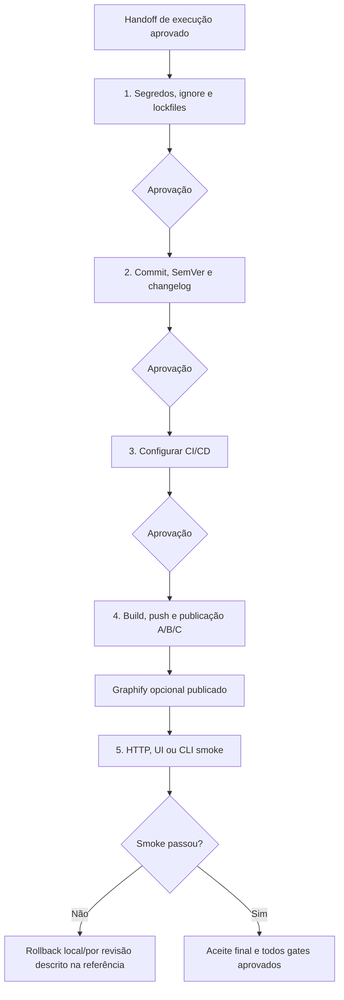

# Auditoria individual: release-and-ops-pipeline

Data: 2026-10-22. Fase 1, quinta meta-skill. Audit-and-refactoring-pipeline aprovada consolidada com quatro referências. Release vigente e suas três referências continuam intactas; proposta em `docs/audits/proposals/release-and-ops-pipeline/`. A Fase 2 de distribuição será executada após a revisão desta última proposta. Não houve publicação, push, deploy ou sincronização de perfis nesta auditoria.

## Parecer

Manter saneamento, versão/notas, CI, publicação e smoke. Tornar o fluxo vinculável a artefato, destino e autorização, separar preparação de publicação e substituir rollback local genérico por recuperação efetiva do destino. Checks precisam falhar quando o contrato falhar, e não somente imprimir status.

## 1. Raio-X

- Frontmatter: name/description de entrega em cinco gates após execution. Audit também é uma origem legítima conforme o contrato das outras pipelines.
- Entrada: docs/00 e fallback para documentos de planejamento; entrega supostamente testada. Não exige identidade explícita do artefato/commit aprovado.
- Saídas: saneamento, changelog, commits/tag, workflows, site/serviço/pacote publicado e homologação.
- Privilégios efetivos: Git local/remoto, contas de CI/hosting/registry e ambiente; não são restringidos por SKILL.md. A regra de autorização de push/deploy existe e deve ser mantida.
- Superfícies: filesystem, terminal, rede, configurações de GitHub Pages, CI, Docker, registries e serviços. Nenhum MCP é declarado; as sub-skills podem usar CLI ou conectores.

| Superfície | Efeito possível | Fronteira proposta |
|---|---|---|
| Git | Staging, commit, tag, push e gatilho de CI | Arquivos explícitos, política de release e autorização do efeito indireto |
| CI | Execução de código com credenciais e publicação | Contexto confiável, job mínimo e artefato identificado |
| Registry/hosting | Exposição pública, upload e substituição de revisão | Conta/destino/artefato definidos, estado terminal observado |
| Dados/outputs | Publicação de tabelas, freeze, HTML e grafo | Revisar conteúdo final, não só .gitignore |
| Smoke remoto | Consultas e ações em aplicação real | Operação mínima sem escrita ou efeitos autorizados |
| Recuperação | Alteração de implantação/schema/pacote | Plano por provedor, versão estável e validação posterior |

## 2. Fluxo atual



O texto tem autorização explícita de push/deploy, mas não discrimina todos os efeitos de tag, registry, GitHub Release, configuração remota ou CI disparado por push. A proposta usa modos de preparação/preview/release/produção e reaproveita autorização específica existente.

### Inventário

23 nomes citados no corpo/matriz, incluindo planning-with-files, escrita e humanizer; exclui skill-loader como infraestrutura e CLIs. 22 entradas localizadas; managing-python-dependencies é citada via plugin e não foi localizada nas pastas de skills consultadas, o que não comprova indisponibilidade em outros hosts.

| Gate | Dependências citadas |
|---|---|
| 1 | codebase-audit-pre-push, managing-python-dependencies, dependency-management-deps-audit, client-secret-exposure-audit |
| 2 | writing-pipeline, humanizer, changelog-automation, git-workflow, git-pushing; git-pr-review na lista geral |
| 3 | github-actions-templates, github-actions-advanced, github-actions-debugger |
| 4 | quarto-expert, docker-expert, docker-compose, deploy-to-vercel, cloudflare-pages, python-packaging, pre-release-review; git-pushing na matriz |
| 5 | shipping-and-launch, webapp-testing, writing-pipeline; pre-release-review na lista geral |
| Estado | planning-with-files |

Leitura dirigida das instruções de push, CI, preparação, deploy e packaging; nenhuma sub-skill foi executada como agente nesta rodada.

### Achados

| ID | Gravidade | Evidência e consequência | Correção |
|---|---|---|---|
| RL-01 | Alta | Smoke sugere checkout de tag como rollback; revert HEAD sem identificar release pode atingir commit errado. | Recuperação no provedor/artefato correto, com autorização e smoke posterior. |
| RL-02 | Alta | G4 mistura build, push, publicação e deploy sem estados nem identidade forte do conteúdo. | Vínculo commit/versão/artefato/destino e confirmação terminal. |
| RL-03 | Alta | Verificador Python de imagens falha com SyntaxError após parsing do shell. | Substituir snippet frágil por parser/checker adequado; verificar execução e não só bash -n. |
| RL-04 | Alta | curl Pages só imprime status; HTTP 404 pode retornar exit 0. API imprime tempo sem impor <2s; não há deadline/retries globais claros. | Assertions de status/conteúdo/versão e limites de execução. |
| RL-05 | Alta | grep de segredo imprime linhas e trata erro de leitura como OK; .gitignore não exclui rastreados ou outputs do pacote/site. | Resultado triestado, redaction e revisão do artefato real. |
| RL-06 | Alta | Modelo CI usa permissões de escrita globais e combina requisitos de gh-pages e artifact Pages. | Uma estratégia, jobs de confiança e permissões necessárias por job. |
| RL-07 | Alta | _freeze e outputs são versionados por padrão sem revisão de conteúdo; raw ignorado pode aparecer em HTML. | Estratégia condicional e inspeção de dados publicados. |
| RL-08 | Média | git-pushing local exclui explicitamente releases versionadas, mas é indicada para release. | Usar fluxo de release do projeto; preparação de comando não é autorização de push. |
| RL-09 | Média | deploy-to-vercel local usa git add . e sugere deployment mais recente após espera fixa. | Arquivos explícitos e ID ligado ao commit/destino, sem inferir pelo último deployment. |
| RL-10 | Média | codebase-audit-pre-push pede varredura linha a linha e correções amplas no fechamento. | Inspeção do conjunto de release; refatoração volta à pipeline adequada. |
| RL-11 | Média | uv sync --frozen não confere atualidade; uv run no checkout não é instalação isolada do wheel. | Check de lock e teste do artefato fora do checkout. |
| RL-12 | Média | 50MB/workspace, CSV/modelos bloqueados e CLI Python obrigatória são universais. | Política de destino e stack real; distinguir fixtures e dados privados. |
| RL-13 | Média | MECA/Binder/PDF/Pages e instalação de browser entram como obrigações de todo A. | Entregáveis e pré-requisitos condicionais ao formato solicitado. |
| RL-14 | Média | Caminhos pessoais, estado planning-with-files e cadeia editorial constante. | Descoberta do host, recursos relativos e estado único. |
| RL-15 | Média | HTTP 200, raiz UI ou /docs são tratados como saúde; --version imposto a toda CLI. | Contrato mínimo real e identidade da versão, sem smoke genérico universal. |
| RL-16 | Média | Qualquer Graphify disponível gera/publica graph.html, sem necessidade/escopo de exposição. | Publicação opcional solicitada, com revisão e cobertura. |
| RL-17 | Média | Tags antigas de actions copiadas sem verificação, sem vínculo imutável ou política de atualização. | Referências verificadas por lock suportado ou SHA; não declarar versão antiga inválida só pela idade. |
| RL-18 | Média | G5 produz todos gates aprovados antes do aceite final humano. | Estado real da execução separado de aceite humano. |

Os exemplos de CI podem funcionar em condições específicas; o achado é excesso de permissões e estratégia pouco discriminada, não falha comprovada de um deploy real. Não se mediu latência de serviço ou vulnerabilidade nesta auditoria.

### Reprodução do snippet de imagens

Os quatro blocos bash da referência passaram em `bash -n`. O primeiro foi executado em diretório temporário contendo docs/index.html e um arquivo image.png, sem rede e sem aplicação real. Com src simples e com query, o Python retornou exit 1 e `SyntaxError: closing parenthesis ']' does not match opening parenthesis '('` na regex. Portanto, sintaxe shell válida não comprova o código Python embutido.

Não se executou curl contra produção. A documentação oficial confirma que status HTTP de erro não é erro de transferência por padrão; a falha do contrato precisa ser verificada explicitamente.

## 3. Alternativas e benchmarking documental

| Capacidade | Alternativa | Ganho e limite |
|---|---|---|
| Prontidão | pre-release-review delimitada + checks do projeto | Foco em bloqueios reais; não é licença para corrigir aplicação inteira |
| Segredos | Gitleaks ou scanner já configurado com resultados minimizados | Repetível no escopo selecionado; ausência de achados não certifica ausência universal |
| CI estático | actionlint e validação da stack | Detecta problemas locais; não executa jobs nem configura proteções remotas |
| Identidade CI | Runs/checks e artefatos ligados ao commit por CLI/conector existente | Evita aprovar run errado; acesso e conclusão precisam ser observados |
| Pages | gh-pages pelo Quarto ou artifact Pages com job separado | Estratégias suportadas; permissões e output variam conforme a escolha |
| Pacote Python | Build + instalação temporária do wheel; Trusted Publishing quando configurado | Testa o artefato e reduz token estático na publicação; não dispensa autorização/destino |
| Smoke | Cliente HTTP com assert/timeout, runner UI e operação mínima do pacote | Evidência de contrato e versão; não prova saúde global |
| Recuperação | Revisão/digest estável do provedor e runbook de dados | Ação remota verificável, sem confundir com checkout local |
| Changelog | Histórico real e política de versão; ferramenta só se automação necessária | Menos ruído para release pontual; prefixo de commit não prova compatibilidade pública |

GitHub documenta permissões distintas para Pages artifacts e proteção de workflows. A documentação consultada também apresenta workflow dependency lockfiles onde suportados e SHA pinning como alternativa; a proposta evita fixar uma versão ou SHA sem conferência. PyPI Trusted Publishing usa identidade OIDC de curta duração, mas precisa de vínculo configurado.

Não se propõe instalar um MCP para Git/CI. Um conector disponível pode consultar ou executar a operação autorizada; para CLI funcional, adicionar catálogo MCP pode apenas ampliar contexto. A escolha depende da capacidade necessária, não de preferência pelo protocolo.

## 4. Matriz de decisão

| Decisão | Elementos | Destino |
|---|---|---|
| Manter | Cinco gates, guardrail de push/deploy e smoke | Explicitar artefato, destino, estados e autorização reutilizável |
| Manter condicional | pre-release-review, github-actions-debugger | Prontidão/falha concreta, não leitura de catálogo inteiro |
| Manter condicional | CI templates/advanced, Docker/Compose, platform deploy e packaging | Ferramenta da stack/destino real, com efeitos revisados |
| Manter condicional | quarto-expert e writing-pipeline | Formato/revisão necessária, sem cadeia obrigatória por commit |
| Substituir | codebase-audit-pre-push amplo | Saneamento do conjunto a enviar, sem refatoração de fechamento |
| Substituir | git-pushing para release | Comando e fluxo de release próprios do repositório |
| Substituir | grep/echo OK e snippet imagem frágil | Scanner/parser adequado e estados de erro separados |
| Substituir | curl só com impressão e uv run no projeto | Assert de contrato remoto e instalação real do artefato |
| Retirar do padrão | planning-with-files, humanizer, git-pr-review | Estado único e revisão dirigida quando efetivamente necessária |
| Retirar do padrão | shipping-and-launch completo para qualquer pacote | Critérios proporcionais de rollout/observação para a entrega específica |
| Corrigir | freeze, MECA, Binder, idioma e Python universais | Condições por documento, linguagem e destino |
| Corrigir | Rollback HEAD/tag e promoção por URL emitida | Revisão estável identificada e confirmação de efeito remoto |
| Corrigir | Graphify publicado pela disponibilidade | Artefato opcional e revisado antes da exposição |

Retirar do padrão não desinstala bibliotecas; as alternativas são recomendações, não ferramentas instaladas nesta rodada.

## 5. Pacote proposto

```
release-and-ops-pipeline/
├── SKILL.md
└── references/
    ├── pre-push-sanitation.md
    ├── ci-and-artifacts.md
    ├── archetype-a-ghpages.md
    └── smoke-and-healthcheck.md
```

Preserva nome, gates, task.md e três nomes de referências legados; acrescenta CI/artefatos para separar confiança de workflow e identidade da entrega. Não há YAML com SHA/versão fictícios, MCP obrigatório ou caminho pessoal. A proposta cobre preparo local sem forçar publicação e aceita origem de auditoria ou execução.

## 6. Verificação e avaliação pendente

O quick_validate.py retornou `Skill is valid!` para a proposta e as quatro meta-skills já consolidadas. Referências locais foram resolvidas e `git diff --check` passou. `git diff --exit-code -- release-and-ops-pipeline` confirmou o pacote vigente intacto. Execution, writing e audit consolidadas foram comparadas byte a byte e por conjunto de arquivos com suas propostas aprovadas. Não houve push, commit, tag, build de aplicação, instalação de pacote, deploy ou rollback remoto nesta auditoria. Teste do snippet original foi isolado em /tmp e não comprova comportamento de uma versão proposta em produção.

| Conteúdo | Original | Proposta | Redução |
|---|---:|---:|---:|
| Núcleo, caracteres | 13.828 | 7.860 | 43,2% |
| Núcleo, linhas | 196 | 64 | — |
| Pacote completo, caracteres | 21.862 | 19.986 | 8,6% |
| Referências | 3 | 4 | — |

Contagens de caracteres Unicode, não tokens. O pacote completo inclui detalhes novos de identidade e confiança em CI; recursos devem ser carregados por gate e necessidade. Não houve benchmark de latência, taxa de sucesso ou consumo real de tokens.

| Caso de avaliação | Critério |
|---|---|
| Pedido só de preparação | Entregar artefato/plano, sem push ou publicação |
| Push aciona produção | Autorização considera destino e efeito indireto |
| Falha de scanner | Não imprimir valores secretos nem declarar ausência de achados |
| Segredo em HTML/_freeze | Detectar no conteúdo do artefato, apesar de raw ignorado |
| HTTP 404 com transferência concluída | Smoke falha explicitamente |
| URL retorna página login ou versão anterior | Não homologar pelo 200 |
| Deployment em fila | Relatar pendente, não concluído nem reenviar cegamente |
| Wheel sem entrypoint | Instalação fora do checkout identifica falha |
| Lock desatualizado | Check específico falha, mesmo que frozen instale |
| Imagem local e src com query | Checker executável não quebra por quoting; resolução considera URL |
| Migração incompatível | Recuperação não presume que trocar imagem desfaz dados |
| Release de shell/TS | Não impor uv/pytest/PyPI |
| Publicação Quarto sem PDF | Não instalar browser ou exigir MECA/Binder |
| Rollback não autorizado previamente | Preparar ação concreta e pedir autorização, sem ação remota implícita |

Comparar modelos/versões equivalentes e mesmos destinos de teste: evidência correta, respeito à autorização, smoke detectando falha, identidade do artefato, recuperação, tokens, chamadas e tempo. Não converter caracteres em promessa de desempenho.

## Fontes oficiais

- [GitHub secure use](https://docs.github.com/en/actions/reference/security/secure-use): confiança, permissões e dependências de workflow.
- [Pages custom workflows](https://docs.github.com/en/pages/getting-started-with-github-pages/using-custom-workflows-with-github-pages): artifact/deploy e permissões.
- [Quarto Pages](https://quarto.org/docs/publishing/github-pages.html): estratégias de publicação e execução.
- [uv sync](https://docs.astral.sh/uv/concepts/projects/sync/) e [packages](https://docs.astral.sh/uv/guides/package/): lock e artefatos.
- [curl](https://curl.se/docs/manpage.html): status HTTP, timeout e limites de retry.
- [PyPI Trusted Publishing](https://docs.pypi.org/trusted-publishers/): OIDC para publicação.
- [actionlint](https://github.com/rhysd/actionlint) e [Gitleaks](https://github.com/gitleaks/gitleaks): verificações determinísticas.
- [SemVer](https://semver.org/): compatibilidade de API e política de versões.


## Consolidação aprovada

Proposta aprovada e aplicada ao pacote ativo antes da Fase 2. O pacote anterior foi arquivado em `docs/audits/legacy/release-and-ops-pipeline/`. Não houve operação de publicação, Git remoto ou implantação.
