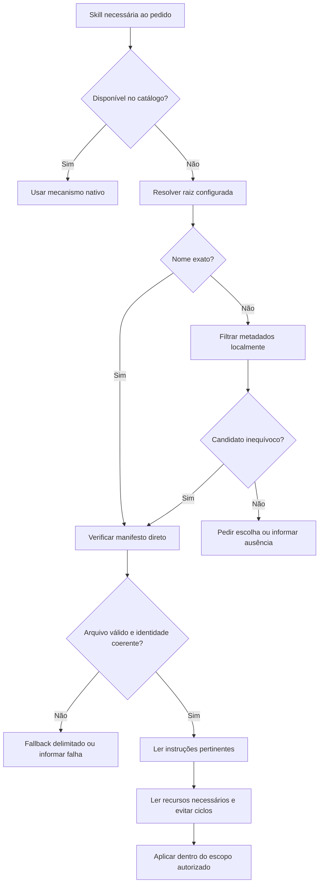

# Auditoria individual: skill-loader

Data: 2026-10-22. Estado: proposta pronta, não aplicada ao pacote ativo.

## Parecer executivo

Manter como adaptador opcional para biblioteca externa. A descoberta nativa do agente deve atender skills já disponíveis; o loader só resolve o acesso pontual ao acervo fora dela. Prioridades: portabilidade, confiabilidade do índice e limitação de dependências/contexto. Não adicionar MCP ou instalador nesta etapa.

## Raio-X e evidências

O pacote contém um único `SKILL.md`, sem scripts, schemas ou referências auxiliares. Frontmatter: `name: skill-loader`; description promete carregar qualquer skill da biblioteca fria. O corpo restringe o gatilho a solicitação explícita, enquanto README e release-and-ops também o apresentam como dependência de etapas do fluxo. Essa inconsistência dificulta seleção automática.

O protocolo atual localiza a biblioteca fixa `/home/tales/.gemini/config/skills-library`, consulta opcionalmente `skills_index.json`, usa a ferramenta nominal `view_file` e manda seguir integralmente o conteúdo encontrado. Não define configuração, precedência de caminhos, falhas, validação do manifesto, identidade, resolução de links ou dependências circulares.

A superfície inicial é leitura do filesystem. Não há comando explícito de escrita, rede, Git ou MCP. Entretanto, as skills carregadas podem solicitar essas capacidades; a ordem de segui-las integralmente deixa uma lacuna de escopo. O loader não é sandbox nem mecanismo de autorização.

Inspeção somente de metadados e existência de arquivos da biblioteca local, sem executar skills externas:

| Medida | Resultado |
|---|---:|
| Tamanho do índice JSON | 2.008.473 bytes |
| Entradas no índice | 2.676 |
| IDs duplicados | 0 |
| Diretórios imediatos na raiz | 2.576 |
| Manifestos diretos existentes | 2.571 |
| Entradas cujo path existe, relativo à raiz | 1 |
| Entradas cujo ID encontra manifesto direto | 2.571 |

Exemplo: o índice registra `skills/00-andruia-consultant`, mas o manifesto é encontrado diretamente por ID na biblioteca. Há 105 IDs sem manifesto direto. Isso não comprova que todas essas skills estejam ausentes de qualquer subpasta; comprova que o índice não corresponde ao layout direto observado. Não foi realizada auditoria do conteúdo dos 2.571 manifestos, de suas licenças ou procedência.

Chamadores: README e release-and-ops ativa. A proposta anterior de release permanece pendente e não foi aplicada. O grafo existente devolveu nós de scripts Quarto antigos, sem evidência útil sobre o loader; a auditoria usa os arquivos-fonte atuais.

## Pipeline

Atual: pedido explícito → caminho pessoal → índice ou listagem → view_file → aplicar integralmente. As buscas não têm limite definido e a leitura dos auxiliares é ampla.

Proposto:

Não orquestra sub-skills fixas: a selecionada e suas dependências são variáveis. Evitar duplicação por caminho canônico, sem prometer descarregar texto já incorporado ao contexto.

## Fragilidades prioritárias

| Prioridade | Problema | Efeito |
|---|---|---|
| Alta | Índice sem base declarada e divergente da biblioteca observada | Caminhos inválidos, seleção incorreta e buscas repetidas. |
| Alta | Aplicação integral sem delimitar escopo e permissões | Skill externa pode introduzir ações não autorizadas pelo pedido. |
| Média | Caminho pessoal e view_file obrigatórios | Falha em outros usuários, sistemas e CLIs. |
| Média | Índice de aproximadamente 2 MB pode ser lido integralmente | Consumo desnecessário de contexto na descoberta. |
| Média | Ausência de controle de ciclos e releituras | Cascata de dependências, loops e duplicação. |
| Média | Referências sem base explícita | Resolução incorreta quando o CWD difere da pasta da skill. |
| Baixa | Description ampla versus gatilho somente explícito | Comportamento divergente entre invocação humana e pipeline. |

## Benchmark e alternativas

| Alternativa | Uso indicado | Decisão |
|---|---|---|
| Descoberta nativa de Codex e Claude Code | Skills selecionadas e disponibilizadas ao agente | Preferir para catálogo ativo; já usam carregamento progressivo. |
| Loader instrucional com filtro local | Acervo externo grande e esporádico | Manter como fallback portátil. |
| CLI de catálogo/doctor | Reconstrução e validação repetível do índice | Implementar no escopo de distribuição da Fase 2, após aprovação; não misturar com carregar. |
| MCP especializado | Catálogo remoto, compartilhado, com autenticação e busca estruturada | Sem necessidade demonstrada para diretório local; custo operacional adicional. |
| Instalar ou expor todo o acervo | Quando um conjunto inteiro é de fato necessário | Evitar por padrão: mesmo descrições concorrem por contexto e seleção. |

Codex carrega inicialmente nome, descrição e caminho, e lê o corpo quando seleciona a skill. A documentação atual informa orçamento da lista inicial e possível omissão em catálogos grandes. Logo, reduzir o corpo não elimina o custo de descoberta: https://learn.chatgpt.com/docs/build-skills

Claude Code carrega o corpo quando usado e dispõe de descoberta própria. O carregamento de skills em diretórios adicionais tem condições específicas; conceder acesso a arquivos não equivale automaticamente a registrar skills: https://code.claude.com/docs/en/skills

Agent Skills recomenda referências relativas à raiz da skill. A proibição geral de caminhos relativos ainda presente no README contraria a portabilidade desejada e deve ser reconciliada na Fase 2: https://agentskills.io/specification

Não foram inferidos caminhos de Antigravity nem capacidades de skills.json nesta auditoria. Esses pontos precisam de verificação oficial específica na arquitetura de distribuição.

## Matriz de refatoração

| Decisão | Elemento | Ganho esperado |
|---|---|---|
| Manter | Biblioteca externa e leitura sob demanda | Evitar exposição permanente de milhares de descrições. |
| Substituir | Caminho pessoal | Raiz explícita/configurada; variável SKILLS_LIBRARY_ROOT como convenção proposta, não recurso nativo. |
| Substituir | view_file obrigatório | Leitor de arquivos disponível no agente. |
| Substituir | Índice tratado como caminho confiável | Verificar manifesto e usar fallback delimitado. |
| Substituir | Aplicação integral | Instruções pertinentes dentro do escopo e das permissões existentes. |
| Remover | Carga implícita ampla de auxiliares | Ler só recursos necessários e evitar ciclos. |
| Separar | Instalação, sincronização e reconstrução do índice | Carregamento não altera o ambiente. |

## Proposta concreta e limites de validação

Arquivo completo em `docs/audits/proposals/skill-loader/SKILL.md`. Nenhum arquivo ativo de skill-loader foi alterado. A proposta é deliberadamente maior que o original, que tinha 1.294 caracteres: acrescenta regras operacionais ausentes; não é uma otimização por tamanho do entrypoint.

Validação estrutural via quick_validate.py. Revisão manual dos cenários: raiz ausente pede caminho; nome exato verifica manifesto; índice obsoleto não causa leitura de todo o catálogo; ambiguidade pede escolha; path/symlink fora da raiz não é adotado como se estivesse dentro dela; dependência circular interrompe a cadeia; ferramenta ausente não é simulada; carregar não instala. Essas são propriedades prescritas, não garantias de enforcement pelo sistema operacional nem resultados de benchmark entre modelos.

Nenhuma skill externa foi executada ou instalada, nenhum índice foi alterado e nenhuma configuração global foi modificada. O índice atual deve ser regenerado por manutenção separada; não foi corrigido silenciosamente durante a auditoria.

## Consolidação aprovada

Proposta aprovada pelo usuário e aplicada ao pacote ativo. O manifesto anterior foi preservado em `docs/audits/legacy/skill-loader/SKILL.md`. O relatório acima documenta o estado anterior e a proposta aprovada. A biblioteca externa e seu índice permanecem sem alterações.
