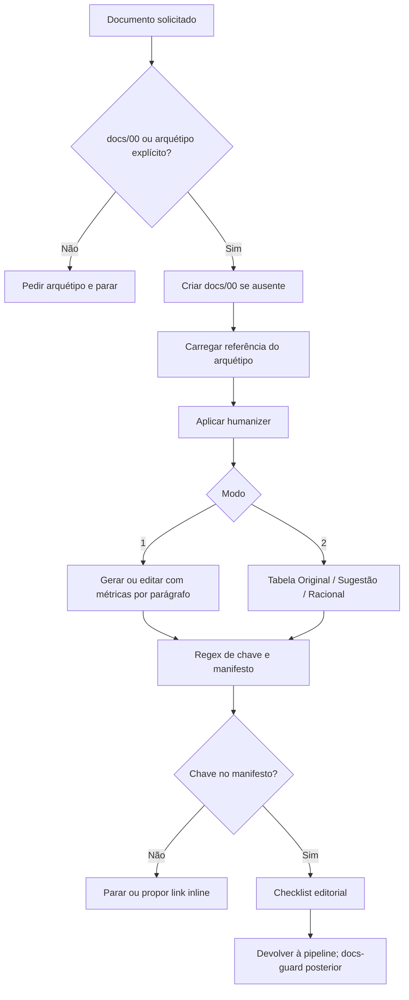

# Auditoria individual: writing-pipeline

Data: 2026-10-22. Fase 1, terceira meta-skill. Execution-pipeline aprovada consolidada no repositório com suas três referências; nenhum perfil global sincronizado. Writing-pipeline vigente e suas sete referências permanecem intactas. Proposta em `docs/audits/proposals/writing-pipeline/`.

Atualização após aprovação do usuário: o pacote proposto foi consolidado em `writing-pipeline/`, com três referências ativas. As sete referências anteriores foram preservadas em `docs/audits/legacy/writing-pipeline/references/` como evidência histórica; não são carregadas pelo novo núcleo. A linha de inventário da escrita no README foi atualizada para não manter links removidos. Perfis globais continuam sem sincronização. A análise e suas medidas abaixo descrevem o estado anterior à aprovação.

## Parecer

Manter os dois modos, preservação de significado e confronto de documentação com evidências. Refatorar a validação de fontes, retirar métricas arbitrárias como condições de aceite e adaptar a escrita ao documento em vez de obrigar um arquétipo em toda revisão. A meta-skill deve produzir texto ou achados, sem governar estado e permissões da pipeline chamadora.

## 1. Raio-X

- Frontmatter: name e description; escopo inclui PRDs, Quarto, README e ADR, com voz sênior anti-IA e adaptação A/B/C. Não há trigger separado.
- Modo 1: gerar/editar documentação. Modo 2: revisão tabular sem reescrever o alvo.
- Entradas: documento, metadados docs/00 e referências de estilo/fontes.
- Dependências diretas de conhecimento: humanizer e quarto-expert; docs-guard aparece como verificador posterior, não rotina executável da escrita. Graphify é fonte opcional passiva. Pre-code, execution, audit e release são chamadores, não sub-skills de redação.
- Não há schema MCP, comando de implementação ou ferramenta ACL declarada. Privilégios vêm do host. A instrução de criar docs/00 introduz escrita de metadados até em tarefa editorial; isso deve ser separado do modo não destrutivo.

| Superfície | Uso atual e risco | Proposta |
|---|---|---|
| Filesystem | Ler/editar texto e gravar classificação de projeto | Editar só alvos autorizados; não criar docs/00 como efeito da revisão |
| Terminal | Regex de citações descrita; exemplos podem induzir execução | Parser/checks quando disponíveis, sem executar exemplos com efeitos sem autorização |
| Web | Links e fontes externas | Fonte primária consultada, sem URLs fictícias |
| MCP/conectores | Nenhum definido | Apenas acesso a fontes privadas já autorizado, quando necessário |
| Outros agentes/skills | Humanizer e Quarto | Especialização sob demanda, sem nova cadeia por docstring |

## 2. Fluxo atual



### Inventário local

O núcleo tem 213 linhas e 9.569 caracteres. As sete referências somam 12.874 caracteres, totalizando 22.443. Há três perfis A/B/C, exemplos, manifesto de fontes, métricas e protocolo de revisão. Humanizer repete várias regras presentes no corpo e em metrics-and-anti-ai, contrariando a intenção declarada de não duplicar.

### Achados priorizados

| ID | Gravidade | Evidência e efeito | Correção |
|---|---|---|---|
| WR-01 | Alta | Manifesto Markdown considera chave listada como válida, sem bibliografia processável nem prova de sustentação. | Separar sintaxe, resolução, identidade e sustentação; usar bibliografia do projeto. |
| WR-02 | Alta | Regex captura somente [@chave] isolada; ignora narrativa, grupos e localizador, e aceita exemplo literal em código. | Parser AST/motor e conferência contextual. |
| WR-03 | Alta | Protocolo e exemplos substituem prosa vaga por 400ms, 2.500 tx/s, 99,9% e números de vendas sem contexto evidencial. | Exemplos explicitamente hipotéticos ou sugestões sem inventar métricas/causalidade. |
| WR-04 | Alta | Instrução literal archetype-{a,b,c}.md não corresponde aos nomes reais academic/software/cli. | Links relativos exatos e verificáveis. |
| WR-05 | Média | Arquétipo obrigatório e criação imediata de docs/00 para qualquer escrita. | Metadados existentes ajudam, mas revisão avulsa usa tipo/público; não alterar alvo no Modo 2. |
| WR-06 | Média | A exige DP ≥6,5 e ≥15% frases curtas; checklist exige alternância para todos, métricas reimpõem percentual a B/C. | Preservar clareza, registro e significado sem cotas universais. |
| WR-07 | Média | Blacklist bane ecossistema/escalável/robusto mesmo como termo preciso. | Distinguir jargão correto de alegação promocional vazia. |
| WR-08 | Média | Só aceita chaves do manifesto; links externos dispensam a mesma checagem; exemplo usa example.com. | Mesma disciplina evidencial para chave e URL; sem contornar validação com link. |
| WR-09 | Média | Chave autorizada de guia de escrita pode parecer suficiente para embasar conteúdo de domínio. | Catálogo editorial é recurso de estilo, não allowlist de todas as fontes do projeto. |
| WR-10 | Média | Modo 2 tem quatro colunas; audit requer ID/localização/severidade/diagnóstico/sugestão/racional. | Preservar schema do chamador e priorização por impacto. |
| WR-11 | Média | Declara não bloquear Gate 5, deixando redação incompleta ao docs-guard posterior. | Retornar estado parcial e pendências; chamador mantém critérios de aceite. |
| WR-12 | Média | A força estruturas ML; B impõe Google Style; C impõe zero prosa e rotula mensagem customizada como POSIX. | Selecionar documento e convenção real, não pressuposto universal do arquétipo. |
| WR-13 | Média | Renderização de diagrama afirma SVG interativo para HTML e PNG para PDF como universal. | Conferir motor, formato e configuração; não prometer saída universal. |
| WR-14 | Média | Existência de GRAPH_REPORT aciona subseção arquitetural sem avaliar pertinência/cobertura. | Consumo opcional pertinente, com atualidade e proveniência. |
| WR-15 | Média | Humanizer obrigatório inclui alegações de detecção e proíbe menções a ferramentas em commits. | Estilo condicionado ao pedido; preservar transparência e políticas do projeto. |
| WR-16 | Média | Paths pessoais, checkpoints e regras repetidas entre núcleo, humanizer e referências. | Núcleo portátil, referências por necessidade e sem estado paralelo. |

Não se afirma que todas as fontes bibliográficas do manifesto sejam falsas. A presença no catálogo não verifica obra, edição nem sustentação. Metadados particulares de livros e normas precisam de conferência antes de migração; esta rodada não certifica sua exatidão.

### Reprodução da falha de regex

Executado localmente com /usr/bin/pandoc, entrada Markdown sintética e saída JSON AST, sem citeproc, rede ou escrita no alvo:

| Entrada | Regex atual | Citações no AST |
|---|---|---|
| [@alpha] | alpha | alpha |
| @alpha afirma. | nenhuma | alpha |
| [@alpha; @beta] | nenhuma | alpha e beta |
| [@alpha, p. 12] | nenhuma | alpha |
| [-@alpha] | nenhuma | alpha |
| código inline contendo [@alpha] | alpha | nenhuma |

Esse experimento prova diferença sintática nesses casos, não validade bibliográfica ou factual. Referências cruzadas Quarto requerem contexto adicional; parser Pandoc isolado não é um validador completo de um projeto Quarto.

## 3. Alternativas e benchmarking documental

| Capacidade | Alternativa | Ganho esperado e limite |
|---|---|---|
| Citações | Bibliografia efetiva + parser/motor Quarto/Pandoc | Menos falsos positivos e negativos; existência da chave não prova sustentação |
| Estilo/termos repetíveis | Vale com regras e escopos do projeto | Check determinístico de consistência; não prova fatos nem substitui edição |
| Estrutura Markdown | markdownlint | Erros estruturais repetíveis; não impor regras incompatíveis com Quarto |
| Links | lychee ou checker do projeto | Detecta links inacessíveis; HTTP 200 não prova conteúdo correto |
| Identidade bibliográfica | Metadados primários e Crossref quando apropriado | Ajuda a resolver DOI/autor/título; não equivale a ler a fonte |
| Autoria Quarto | quarto-expert e guias Posit de modalidade específica | Preservar especialista existente; não duplicar manual completo |
| Fontes privadas | Conector/MCP já autorizado | Recuperação de conteúdo necessário; sem instalar servidor para editar texto local |
| Edição curta | Capacidades nativas do host | Evita carregar humanizer e catálogo inteiro para correção localizada |

Não se recomenda MCP novo para reescrever parágrafos, contar palavras ou guardar estado editorial. Uma conexão pode ajudar a buscar evidências remotas; acesso não comprova a afirmação. Tool schemas e documentos completos não devem ser carregados sem necessidade.

Guias Google enfatizam clareza e consistência contextual. Esta auditoria não encontrou no pacote uma justificativa reproduzível para tratar o DP 6,5 ou 15% de frases curtas como requisito universal de qualidade. Remover a cota não autoriza texto verboso ou promocional.

## 4. Matriz de refatoração

| Decisão | Elementos | Destino |
|---|---|---|
| Manter | Modos 1/2 e edição que preserva significado | Núcleo com limites claros de escrita |
| Manter | Original → Sugestão → Racional | Protocolo compatível com schema do chamador |
| Manter | Conferência de fatos, comandos e fontes | Evidências materiais com estado explícito |
| Manter sob demanda | quarto-expert | Configuração/renderização Quarto, sem paths pessoais |
| Tornar opcional | humanizer | Revisão de estilo pedida/necessária, sem prevalecer sobre fatos |
| Substituir | canonical-sources como allowlist universal | Bibliografia/metadados efetivos do documento |
| Substituir | Regex de citação | Parser/motor e checagem de casos relevantes |
| Substituir | Perfis A/B/C rígidos | Convenções por PRD, ADR, API, CLI, relatório e release |
| Remover como gate | DP, burstiness, quota de palavras e blacklist absoluta | Clareza e preservação de precisão, com regras opcionais configuradas |
| Remover | Números/SLAs sem proveniência nos exemplos | Lacuna explícita ou exemplo identificado como hipotético |
| Remover do padrão | Criação de docs/00 e novo plano editorial | Usar contexto existente e devolver resultado ao chamador |
| Reduzir | Releitura de múltiplas referências e cadeia editorial | Ler apenas modalidade, evidência e protocolo necessários |
| Corrigir | Não bloqueia Gate 5 | Retornar pendências impeditivas, sem aprovar gate |
| Corrigir | Subseção Graphify pela mera existência | Seleção por pertinência e cobertura |

Remover do padrão significa retirar uma dependência da proposta; humanizer e os recursos vigentes não foram apagados ou auditados integralmente como pacotes independentes.

## 5. Proposta e contratos

```
writing-pipeline/
├── SKILL.md
└── references/
    ├── document-types.md
    ├── citations-and-evidence.md
    └── review-protocol.md
```

Mantém nome e Modos 1/2. Aceita contexto de arquétipo sem exigir criar classificação para escrita avulsa. Preserva schema de audit-and-refactoring e retorna o estado ao chamador sem marcar aprovações. Acrescenta release notes/PR/commit porque release-and-ops já encaminha esses textos.

Não remove citações de documentos existentes nem troca padrões institucionais. A proposta não migra os sete arquivos legados nesta rodada; consolidação após aceite deve escolher o pacote completo proposto e evitar carregar os recursos antigos por engano. Não há licença nova, campo de host ou schema MCP inventado.

## 6. Verificações e aceite

O quick_validate.py retornou `Skill is valid!` para o pacote proposto e para as duas meta-skills já consolidadas. Referências locais foram resolvidas, `git diff --check` passou e `git diff --exit-code -- writing-pipeline` confirmou que o pacote vigente permanece intacto. O pacote consolidado da execution-pipeline foi comparado byte a byte com a proposta aprovada. Não houve benchmark de escrita com múltiplos modelos nem certificação factual dos exemplos legados. Nenhuma ferramenta opcional foi instalada.

| Conteúdo | Original | Proposta | Redução |
|---|---:|---:|---:|
| Núcleo, caracteres | 9.569 | 6.147 | 35,8% |
| Núcleo, linhas | 213 | 46 | — |
| Pacote completo, caracteres | 22.443 | 14.209 | 36,7% |
| Referências | 7 | 3 | — |

Contagens de caracteres Unicode, não tokens. Linhas longas condensam parte das instruções. O custo de execução depende das referências e especialistas efetivamente carregados, além do documento analisado; não há promessa de redução equivalente de latência ou tokens.

| Caso de avaliação | Critério |
|---|---|
| Parágrafo sem arquétipo | Revisar sem criar docs/00 ou parar por classificação irrelevante |
| Revisão não destrutiva | Alvo idêntico, achados no schema solicitado |
| Texto rápido sem medição | Não inventar throughput ou SLA |
| PRD com meta futura | Não transformar meta em resultado medido |
| Citações agrupadas/narrativas/páginas | Identificar chaves reais, excluindo código literal |
| Chave válida no projeto e ausente do catálogo editorial | Aceitar resolução sem exigir editar manifesto global |
| DOI/link existente sem trecho consultado | Não declarar sustentação verificada |
| Termo robustez estatística | Preservar termo preciso apesar de blacklist legada |
| Documento Quarto com @fig | Não confundir referência cruzada com fonte bibliográfica |
| Comando de documentação com efeito externo | Inspecionar sem executar fora da autorização |
| Falta de evidência parcial | Entregar trecho seguro ou achado e indicar limitação |
| Relatório de grafo incompleto | Não expandir métricas para arquitetura inteira |

Comparar original e proposta com mesmo texto, modelo e permissões; medir fidelidade factual, precisão dos achados, citações resolvidas, regressões semânticas, tokens, leituras, tempo e perguntas desnecessárias. Caracteres não equivalem a tokens ou qualidade.

## Fontes oficiais

- [Quarto: citations](https://quarto.org/docs/authoring/citations.html): bibliografias e formas de citação.
- [Pandoc Manual](https://pandoc.org/MANUAL.html#citations): AST e processamento bibliográfico.
- [Vale](https://docs.vale.sh/) e [escopos](https://vale.sh/features/markup): lint de estilo com conhecimento do markup.
- [markdownlint](https://github.com/DavidAnson/markdownlint): checks estruturais de Markdown.
- [lychee](https://github.com/lycheeverse/lychee): verificação de links.
- [Crossref REST API](https://www.crossref.org/documentation/retrieve-metadata/rest-api/): metadados bibliográficos.
- [Google developer style](https://developers.google.com/style/tone): clareza e tom contextual.
- [Posit skills](https://github.com/posit-dev/skills): recursos especializados em Quarto.
