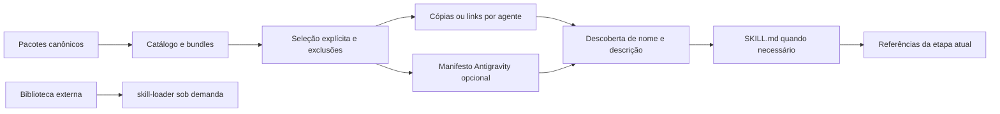

# Distribuição multiagente

Implementado em 2026-10-22 após aprovação e consolidação das oito auditorias. Fonte única: oito pacotes na raiz; catálogo versionado em `distribution/catalog.json`; CLI em `scripts/skills.py`. Arquivos históricos e propostas não são pacotes distribuíveis.

## Governança documental vigente

Política adotada na MOD-004 (2026-10-28). Consumidores: mantenedor, autores de skills, revisores e operadores de distribuição. Este guia mantém a propriedade da informação; os documentos apontados mantêm seu conteúdo, sem cópia obrigatória entre pipelines.

| Informação | Fonte canônica | Mantenedor / consumidor | Quando conferir |
|---|---|---|---|
| Escopo e autorização | Pedido atual e contrato aprovado da tarefa | Usuário / executor | Antes de agir; autorização histórica não amplia tarefa nova |
| Comportamento requerido | Contrato aprovado, referenciado no task | Responsável pelo requisito / implementador e revisor | Mudança de requisito ou discrepância com código |
| Comportamento observado | Código, testes e saídas com base identificada | Autor da mudança / revisor | Mudança funcional e validação |
| Seleção, bundles e release | `distribution/catalog.json` | Mantenedor da distribuição / CLI e operador | Alteração de pacote ou release; conferir derivados no README |
| Identidade e procedimento da skill | Frontmatter e corpo do `SKILL.md` ativo | Autor da skill / host e chamador | Alteração do contrato; referências especializadas sob demanda |
| Instalação e comandos | CLI e este guia; biblioteca em `docs/library-maintenance.md`; evals em `docs/evals.md` | Mantenedor do componente / operador | Mudança de interface, dependência ou recuperação |
| Estado vigente | Seção inicial de `task.md`, com base, autorização e próxima ação | Executor / retomada | Por tarefa ou check; registros anteriores permanecem históricos |
| Decisões duráveis | ADR aprovado, quando necessário | Responsável pela decisão / futuros autores | Mudança arquitetural relevante; nenhum ADR obrigatório por tarefa |
| Resultado verificado | Log/artefato datado com comando, ambiente, base e limites | Executor / avaliador | Nova execução; não substituir resultado anterior |
| História e propostas | Auditorias datadas, `legacy/`, `proposals/` e planos anteriores | Mantenedor como custodiante / auditor | Consulta explícita; não são procedimento ativo nem autorização |

Quando código e requisito aprovado divergem, investigue e registre a decisão antes de alterar qualquer fonte. Documentação de uso deriva do contrato e da evidência; código não é autoridade absoluta sobre comportamento esperado. Conteúdo sem consumidor conhecido recebe investigação, não exclusão automática.

Atualize apenas as fontes afetadas, com finalidade e consumidor claros. Correção local pode usar o contrato existente; mudança de interface exige conferir exemplos e compatibilidade; decisão arquitetural relevante registra alternativas e consequências; experimento preserva método, configuração e proveniência. A MOD-005 permite que contratos equivalentes aprovados satisfaçam gates por referência, com esforço e motivo registrados. Os procedimentos são mantidos nos próprios pacotes de planejamento, execução e auditoria, sem dependência deste guia na instalação. Esforço não amplia autorização nem elimina segurança, teste pertinente, evidência ou recuperação; assistido/contínuo continuam regulando aprovações.

Arquive somente com motivo/data, fonte sucessora e consumidor verificados; preserve histórico Git e resultados necessários à reprodução. Não apague cópias históricas por hash, baixa frequência de leitura ou quantidade de linhas. Antes de remover material de valor incerto, obtenha decisão do mantenedor. Não carregue histórico nem referências inteiras por padrão.

## Handoff e retomada

As quatro pipelines principais mantêm o mesmo contrato mínimo em seus próprios pacotes, sem depender de um arquivo externo à instalação. Use uma seção datada no estado já adotado, com um executor por fatia e referências aos artefatos originais. Exemplo ilustrativo, sem alegar execução ou autorização real:

```markdown
## Handoff — 2026-10-28
- Objetivo/estado/base: correção do rótulo; preparado; fixture-r1 (revisão simulada).
- Escopo/autorização: só preparar handoff, conforme pedido de 2026-10-28; implementação não autorizada.
- Executor da próxima fatia: execution-pipeline, somente para conferir condições de entrada.
- Fontes/decisões/pendências: contrato em issue.md; API preservada; falta autorização de implementar.
- Checks: inspeção documental concluída na base declarada; testes de aplicação não executados.
- Restrições/próxima ação: revisar o handoff e relatar estado; não implementar nem publicar.
```

O consumidor confere base, diff e referências antes de reutilizar autorização ou resultado de check. Mudança de base não obriga repetir uma aprovação ainda válida, mas exige revalidar o que foi afetado; mudança material de escopo/artefato/destino interrompe a ação dependente. Registre limites quando não houver snapshot para comparar bases; não invente diff histórico. O produtor encerra sua fatia ou registra transferência de responsabilidade, sem auditoria e execução implementarem a mesma tarefa simultaneamente. Um handoff preparado não prova execução, e aprovação de plano não autoriza implementar.

## Compatibilidade

| Ambiente | Projeto | Usuário | Comportamento adotado |
|---|---|---|---|
| Antigravity App/IDE | `.agents/skills/` | `~/.gemini/config/skills/` | `--agent antigravity` |
| Antigravity CLI | `.agents/skills/` | `~/.gemini/antigravity-cli/skills/` | `--agent antigravity-cli` |
| Claude Code local | `.claude/skills/` | `~/.claude/skills/` | `--agent claude` |
| Codex | `.agents/skills/` | `~/.agents/skills/` | `--agent codex` |
| Framework customizado | Diretório explícito | Diretório explícito | `--destination PATH`; consumidor implementa descoberta |

Os caminhos refletem documentação consultada nessa data, não um teste de descoberta em todas as aplicações. A pasta de usuário do Codex aqui segue a documentação atual; instalações legadas em `~/.codex/skills` não são migradas nem removidas. Antigravity mantém compatibilidade com `.agent/skills`, mas o instalador usa `.agents/skills`. Gemini CLI é um produto distinto e não é um alias de Antigravity neste instalador.

Fontes: [Antigravity](https://antigravity.google/docs/skills/), [Claude Code](https://code.claude.com/docs/en/skills), [OpenAI](https://learn.chatgpt.com/docs/build-skills).

## Descoberta e controle de contexto



Três níveis operacionais, sem inventar um enum nativo de discoverability:

1. **Ativo:** somente as skills selecionadas são expostas ao catálogo nativo. Seu nome/descrição podem ocupar contexto inicial.
2. **Biblioteca externa:** demais skills permanecem fora dos diretórios de descoberta; `skill-loader` recebe uma raiz configurada e localiza recursos pontualmente.
3. **Histórico:** `docs/audits/legacy/` e propostas não devem ser registrados como raízes de skills.

Nenhum orçamento universal de 20.000 tokens ou contagem fixa por skill é presumido. A configuração e os limites variam por host. Remover uma skill do catálogo não apaga instruções já lidas em uma conversa.

### Antigravity e skills.json

O comando `manifest` gera JSON com `entries[].path` para cada skill selecionada. O formato de entradas individuais é demonstrado pelo [projeto Chromium mantido no Google](https://chromium.googlesource.com/experimental/chromium/src/+/HEAD/agents/skills/README.md). O [changelog oficial](https://github.com/google-antigravity/antigravity-cli/blob/main/CHANGELOG.md) também registra suporte a exclusões e filtros.

Não é necessário usar `skills.json` quando os pacotes já estão nas pastas padrão. Para registrar fontes externas, gere o manifesto, revise-o e incorpore as entradas ao `.agents/skills.json` do workspace ou ao manifesto global compatível com sua versão. Não registre as mesmas fontes por múltiplos mecanismos sem necessidade.

```bash
python3 scripts/skills.py manifest --bundle research --exclude execution-pipeline
```

O instalador aplica `--exclude` antes de gerar entradas; não depende de semântica não validada de padrões nativos de exclusão. Ele não sobrescreve nem mescla automaticamente configurações existentes. Não foram confirmados enums públicos universais de discoverability; campos assim não são emitidos. Os caminhos gerados são absolutos para a máquina atual: regenere ao mudar de máquina ou checkout.

## Contratos e schemas

- Cada pacote usa YAML frontmatter em `SKILL.md` com `name` e `description`, seguindo [Agent Skills](https://agentskills.io/specification). Referências de recursos são relativas ao arquivo que as contém, dentro do pacote; o entrypoint parte da raiz da skill.
- O catálogo usa schema JSON versão 1 e release SemVer; `distribution/catalog.schema.json` publica o contrato declarativo. A CLI valida campos, versão, release, tipos, unicidade e pertencimento de membros aos nomes do catálogo com verificações locais; não depende de um motor genérico de JSON Schema.
- `doctor` valida sintaxe YAML e chaves duplicadas do frontmatter e dos recursos `.yml`/`.yaml`, identidade de nome, descrição e metadata string/string. Verifica existência e confinamento dos destinos de links Markdown inline no entrypoint e em `references/**/*.md`, relativos ao arquivo que contém o link. Ignora código cercado por backticks/tis e código inline, URLs externas e fragmentos sem arquivo; para `arquivo.md#seção`, confere o arquivo, sem certificar a âncora. Links por definição/HTML e títulos opcionais em links não fazem parte deste checker. `examples/` e históricos fora dos pacotes ativos ficam fora da varredura documental, mas YAML e restrições de symlinks do pacote continuam verificados. A mesma validação precede `manifest`/`install`, sem buscar rede ou executar snippets. Não é um validador completo de Markdown, de todas as extensões dos hosts ou dos schemas Quarto.
- As cópias são registradas por caminho relativo e SHA-256 dos arquivos. O doctor detecta divergências em cópias gerenciadas. Links são fontes vivas: verifica destino e estrutura, sem afirmar imutabilidade do conteúdo.
- `agents/openai.yaml` é opcional no Codex para interface, política e ferramentas. Nenhum dos oito pacotes exige MCP ou bloqueio de invocação implícita por padrão. Não foram adicionadas dependências fictícias ou políticas globais.

### Integração MCP/customizada

MCP conecta ferramentas e dados; a distribuição de uma pasta de skill não inicia um servidor. Um framework pode indexar apenas frontmatter do conjunto selecionado e disponibilizar busca e leitura pontuais, preservando instruções do host e escopo do pedido.

`distribution/mcp-tools.example.json` contém definições ilustrativas de ferramentas para esse adaptador. **Não existe servidor implementado ou registrado por esta entrega.** Uma implementação precisa validar IDs contra catálogo, fixar raízes permitidas, limitar resposta e proteger leitura de referências. O corpo da skill não deve virar instrução de sistema nem concessão de permissões. Scripts continuam sujeitos ao executor e às permissões do host. Para catálogo local pequeno, o filesystem nativo já atende; MCP só se justifica quando há necessidade de acesso remoto ou compartilhado.

## Seleção e instalação

Python 3.9+ e PyYAML 6.0.3. O instalador não baixa dependências nem executa scripts das skills. Crie um ambiente isolado conforme seu sistema:

```bash
python3 -m venv .venv
.venv/bin/python -m pip install -r distribution/requirements.txt
.venv/bin/python scripts/skills.py list
```

Nos exemplos seguintes, `python3` representa o interpretador com PyYAML instalado; use `.venv/bin/python` ou ative esse ambiente.

Windows: use `py -3 -m venv .venv` e `.venv\Scripts\python.exe` nos comandos seguintes. A CLI usa pathlib e não exige bash. Cópia é o padrão multiplataforma; links dependem de suporte/permissões do sistema e não têm fallback silencioso.

```bash
# Planejar uma instalação no projeto sem gravar no destino
python3 scripts/skills.py install --agent codex --bundle development --dry-run

# Disponibilizar somente o pacote editorial no projeto atual
python3 scripts/skills.py install --agent claude --bundle editorial

# Desenvolvimento local com atualização imediata da fonte
python3 scripts/skills.py install --agent antigravity --skill quarto-expert --mode link

# Copiar para perfil do usuário explicitamente selecionado
python3 scripts/skills.py install --agent codex --scope user --skill skill-loader

# Destino customizado ou teste isolado
python3 scripts/skills.py install --destination /tmp/selected-skills --bundle research
python3 scripts/skills.py doctor --destination /tmp/selected-skills --bundle research
```

Bundles são agrupamentos por papel, não grafos de dependência obrigatória. `planning`, `development`, `editorial`, `research`, `release` e `library` estão no catálogo. É possível repetir `--bundle` e `--skill`, combinar seleções e excluir nomes exatos. Instalar tudo exige `--all`; não existe promoção automática da biblioteca fria.

`--agent auto` dá preferência a indícios de sessão Codex/Claude, depois verifica executáveis. Detecção é heurística, não prova de autenticação ou agente ativo. Se houver múltiplos candidatos sem evidência de sessão, falha antes de escrever e pede `--agent`. `detect` mostra o diagnóstico; `--destination` ignora agente/escopo para destinos customizados.

## Atualização e preservação de trabalho

O arquivo `.meta-skills-install.json` no destino registra somente pacotes gerenciados, incluindo a release do catálogo usada na instalação. Um destino homônimo sem registro é preservado e causa erro. As cópias incluem `SKILL.md`, `references`, `scripts`, `examples`, `assets` e `agents`; excluem caches, propostas e arquivos da raiz do repositório. Links expõem a pasta fonte viva inteira, incluindo arquivos adicionais que ela eventualmente contenha; o agente só deve carregar os recursos necessários.

```bash
python3 scripts/skills.py install --agent claude --bundle editorial --update
```

Repetir a mesma instalação e release é idempotente. Mudança de release, atualização de conteúdo ou troca de cópia/link exige `--update`; cópias com alteração local são preservadas mesmo com essa opção. Faça a reconciliação manual antes de repetir. Selecionar um bundle menor não remove pacotes instalados anteriormente. Não há remoção automática nem migração dos perfis antigos.

Conflitos são verificados em todo o plano antes da gravação. Cada pacote é preparado no filesystem do destino, trocado e registrado com recuperação caso a gravação falhe. A transação é por pacote: falha de I/O em um pacote posterior pode deixar os anteriores instalados e registrados. Reexecute após resolver o erro. Execuções concorrentes no mesmo destino não são suportadas; não rode dois instaladores simultaneamente. Mover/apagar o checkout quebra links e exige reinstalação.

## Doctor e evidências

```bash
python3 scripts/skills.py doctor
python3 -m unittest discover -s tests -v
python3 quarto-expert/scripts/doctor.py
```

Sem destino, `doctor` verifica os pacotes fonte. Com `--destination`, verifica pacotes selecionados do destino e integridade quando houver registro. Um pacote não gerenciado recebe apenas verificação estrutural. Saídas da CLI são JSON: código 0 para êxito, 1 para erro, 2 para dependência indisponível. Falta de PyYAML não é sucesso.

A validação não executa workflows de release, pesquisa fontes externas, inicia MCPs ou certifica conformidade normativa dos documentos. O doctor da Quarto oferece runtime e render smoke separados. Instalação no filesystem não comprova que uma aplicação já carregou a skill; siga o [protocolo de descoberta](discovery.md) depois de recarregar o host. Casos e traces comportamentais estão descritos em [avaliações](../evals.md).
