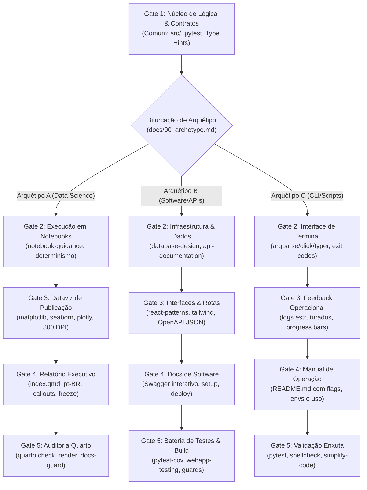

# Skill: execution-pipeline

Este playbook conduz a fase de execução técnica pós-planejamento. A esteira lê os contratos firmados no pré-código e ajusta os requisitos de entrega ao arquétipo do repositório.

---

## 0. Contrato de Herança de Arquétipo

Antes de executar qualquer comando ou criar arquivos, a esteira precisa identificar a natureza do projeto.

1. **Leitura de Contexto**:
   - Inspecione a raiz do repositório procurando por `docs/00_archetype.md`.
   - O arquivo deve conter os metadados base:
     ```yaml
     ---
     archetype: A # A = Data Science/Quarto | B = Software/APIs/Web | C = CLI/Automação
     stack: <string>
     project_name: <string>
     gerado_por: pre-code-pipeline
     data: <ISO8601>
     ---
     ```

2. **Mecanismo de Fallback**:
   - Se `docs/00_archetype.md` estiver ausente, procure declarações explícitas de arquétipo (`archetype: A|B|C` ou `Arquétipo [A/B/C]`) nos seguintes arquivos da fase pré-código:
     1. `docs/02-PRD-and-specs.md`
     2. `docs/05-implementation-plan.md`
   - Caso encontre, reconstrua o arquivo `docs/00_archetype.md` para assegurar a persistência do contexto.

3. **Critério de Bloqueio (Stop Condition)**:
   - Se o arquétipo continuar ausente após a verificação de fallback e não for declarado na invocação da skill, **PARE imediatamente**.
   - Pergunte ao usuário qual é o arquétipo do projeto (`A`, `B` ou `C`) e a stack adotada antes de qualquer ação.
   - **Nunca assuma o arquétipo por heurística de stack ou inferência cega.** A adoção precipitada do Arquétipo A para sistemas ou APIs desestabiliza a esteira de engenharia.
   - Se uma skill marcada como Cold Storage no Gate 3A (ex.: `seaborn`) não carregar via `skill-loader`, **PARAR e reportar**. Não substituir silenciosamente por `matplotlib` puro.
   - Se uma skill marcada como Cold Storage no Gate 5 (ex.: `clean-code-guard`) não carregar via `skill-loader`, **PARAR e reportar**. Não prosseguir com a entrega sem auditoria de código.
   - Se o projeto exigir DuckDB explicitamente (declarado em `docs/02-PRD-and-specs.md`), **PARAR e propor**: (a) criar skill `duckdb`, (b) aceitar degradação documentada via `polars.SQLContext`.
   - Se uma skill de plugin referenciada pela esteira (ex.: `notebook-guidance` no Gate 2A) não estiver disponível no contexto por exclusão de orçamento do Antigravity, **PARAR e reportar**. Não prosseguir sem a skill de governança de notebooks.

4. **Grafo de Execução Polimórfico**:



---

## 1. Gate 1: Núcleo de Lógica e Contratos (Comum aos 3 Arquétipos)

- **0. Pré-checagem de skills**: Ler a lista de skills do arquétipo em questão. Para cada uma que estiver em Cold Storage, rodar `skill-loader` antes de iniciar a escrita de código.
- **Objetivo**: Construir a lógica de negócio central e funções atômicas em `src/`, com tipagem estrita e testes unitários definidos antes da implementação.
- **Skills Mobilizadas**:
  - `clean-code`: Funções coesas, responsabilidade única e limites claros de aninhamento.
  - `python-pro`: Tipagem estrita com Type Hints, Pydantic e convenções do Python moderno.
  - `tdd-workflow`: Ciclo Red-Green-Refactor como condutor do desenvolvimento.
  - `pytest-skill`: Implementação de suítes de teste com fixtures e parametrização.
  - `writing-pipeline`: Governança de docstrings e comentários técnicos alinhados ao arquétipo.
- **Validação e Ferramental**: Uso obrigatório de `uv run pytest` e `uv run ruff check .` como validadores padrão do Gate 1.
- **Artefatos de Saída**:
  - Módulos em `src/` com interfaces públicas limpas e anotações de tipo completas.
  - Arquivos de teste correspondentes em `tests/` com execução limpa no `pytest` (`uv run pytest`).
  - Docstrings concisas no formato Google Style documentando parâmetros, retornos e exceções.
- **Critério de Parada**: Suíte de testes rodando sem falhas no ambiente (`uv run pytest`), validação limpa de linting e formatação (`uv run ruff check .`) e aprovação dos contratos de entrada e saída.

---

## 2. Gate 2: Integração e Execução (Polimórfico)

- **Objetivo**: Conectar a lógica do Gate 1 ao mecanismo primário de execução do arquétipo.
- **Operação por Arquétipo**:
  - **Arquétipo A (JupyterLab / Análise de Dados)**:
    - *Skills:* `notebook-guidance`, `polars`, `scikit-learn`, `statsmodels`, `ponytail` *(código analítico enxuto)*.
    - Execução estruturada cobrindo as etapas do CRISP-ML(Q): Data Preparation & Feature Engineering (Seção 3), Statistical & ML Modeling com Baselines e Modelos Candidatos (Seção 4) e Evaluation, Diagnostics & Explainability via SHAP/resíduos (Seção 5).
    - **Diretriz Ponytail em Data Science (Simplicidade Sem Perda de Rigor)**:
      - *O que eliminar (Anti-Overengineering):* Proibição estrita de classes wrappers OOP desnecessárias (`class PipelineCleaner`, `class FeatureTransformer`) para fluxos lineares; priorize funções puras e encadeamentos vetorizados nativos (`polars.Expr`, `pandas.pipe`, `numpy`). Proibição de bibliotecas acessórias para tarefas já cobertas pela stack padrão.
      - *Cláusulas Pétreas (Rigor Inegociável):* Prevenção de *data leakage* (`fit` estrito no treino), validação de contratos de dados (`patito`/`pandera`), tratamento explícito de nulos/outliers, sementes fixas (`random_state`), verificação de pressupostos estatísticos, diagnóstico de resíduos e explicabilidade via SHAP.
    - Proibição estrita de dados sintéticos sem aviso ou troca arbitrária de estimadores.
    - Sementes fixas (`random_state` / `seed`) para reprodutibilidade estrita.
    - Qualquer diagrama de arquitetura, fluxo ou topologia inserido no relatório deve usar executable cells (` ```{mermaid} ` ou ` ```{dot} `) com cell options canônicas (`%%|` ou `//|`), NUNCA code blocks genéricos sem chaves.
  - **Arquétipo B (Software / Web / APIs)**:
    - *Skills:* `database-design`, `api-documentation`, `fastapi-pro` *(Cold Storage)*.
    - Implementação de repositórios, migrações de banco e clientes externos.
    - Contratos de rotas, esquemas de payload e injeção de dependências.
  - **Arquétipo C (CLI / Scripts / Automação)**:
    - *Skills:* `python-pro`, `ponytail`.
    - Implementação de comandos via `argparse`, `click` ou `typer`.
    - Tratamento explícito de `stdin`, `stdout` e `stderr`. Códigos de saída POSIX (`0` para sucesso, `>0` para falhas).
- **Artefatos de Saída**:
  - *A:* Notebook `.ipynb` executado de ponta a ponta, com saídas persistidas.
  - *B:* Repositórios, migrações e rotas funcionais.
  - *C:* Script executável com parser de argumentos ativo.
- **Critério de Parada**: Execução do fluxo de integração validada pelo usuário.

---

## 3. Gate 3: Apresentação e Visual (Polimórfico)

- **Objetivo**: Estruturar a camada visual ou as respostas externas do projeto.
- **Operação por Arquétipo**:
  - **Arquétipo A (Dataviz de Publicação)**:
    - *Skills:* `matplotlib`, `seaborn` *(Cold Storage)*, `plotly`.
    - Consulta obrigatória à Seção 3 do arquivo `/home/tales/.gemini/config/skills/pre-code-pipeline/references/quarto-quality-checklist.md`.
    - Subfiguras lado a lado geradas em painel único com `fig, axes = plt.subplots(1, 2, figsize=(12, 5.2), constrained_layout=True)`.
    - **Checklist de Entrega de Gráficos**:
      - [ ] DPI >= 300 explícito nas exportações (`dpi=300`) ou formato vetorial SVG.
      - [ ] Remoção ativa de bordas superiores e direitas (`sns.despine()` ou manipulação direta de `ax.spines`).
      - [ ] Proporção de aspecto 1:1 (`ax.set_box_aspect(1)`) onde aplicável (dispersão, curvas ROC/PR, matrizes de confusão).
      - [ ] Grid sutil (`alpha=0.25`, `linestyle='--'`) e anotações numéricas diretas em pontos de destaque.
      - [ ] Salvamento físico em `reports/figures/`.
  - **Arquétipo B (Frontend ou Serialização de API)**:
    - *B-UI (Aplicações com Tela):* `frontend-design`, `react-patterns`, `tailwind-design-system`. Componentes acessíveis, responsivos e fiéis ao design system.
    - *B-API (Serviços sem Tela):* Serializadores JSON rápidos, documentação OpenAPI interativa (Swagger UI) e cabeçalhos semânticos.
  - **Arquétipo C (Logs e Retorno de Terminal)**:
    - *Skills:* `python-pro`, `clean-code`.
    - Saída com logs estruturados, barras de progresso para loops demorados e mensagens claras sem stack traces desnecessários.
- **Artefatos de Saída**:
  - *A:* Imagens em alta resolução versionadas em `reports/figures/` e células de plot consolidadas.
  - *B:* Telas operacionais ou documentação Swagger acessível no navegador.
  - *C:* Execução limpa no terminal com retornos claros.
- **Critério de Parada**: Aprovação dos artefatos visuais ou formatos de saída pelo usuário.

---

## 4. Gate 4: Redação Técnica e Documentação (Polimórfico)

- **Objetivo**: Redigir o documento final, relatório ou manual do projeto, com tom sóbrio e foco em clareza técnica.
- **Regra Transversal**:
  - Todo o texto produzido é governado pela skill writing-pipeline (/home/tales/.gemini/config/skills/writing-pipeline/SKILL.md) em coordenação com humanizer. Mantenha tom sênior, adapte o registro ao arquétipo (A, B ou C) e elimine vícios de IA.
- **Operação por Arquétipo**:
  - **Arquétipo A (Relatório Quarto / `.qmd`)**:
    - *Skills:* `writing-pipeline`, `data-storytelling`, `humanizer`, `quarto-expert` (`/home/tales/.gemini/config/skills/quarto-expert/SKILL.md`).
    - Consulta obrigatória às Seções 1, 2 e 4 do arquivo `/home/tales/.gemini/config/skills/pre-code-pipeline/references/quarto-quality-checklist.md` e às regras de sintaxe `#|`, referências cruzadas `@fig-`/`@tbl-`, `` e compilação da `quarto-expert`.
    - Estruturação mandatória do `index.qmd` nas **6 Seções Canônicas do CRISP-ML(Q) + Data Storytelling** (ou IMRAD se acadêmico estrito):
      1. *Contexto de Negócio & Hipóteses (Business Understanding / Ask)*
      2. *Auditoria de Dados & Contratos (Data Understanding / Prepare)*
      3. *Análise Exploratória & Engenharia de Atributos (Data Prep & EDA / Process)*
      4. *Modelagem Estatística & Machine Learning (Modeling / Construct)*
      5. *Avaliação, Diagnóstico & Explicabilidade (Evaluation / Share)*
      6. *Recomendações Executivas & Plano de Ação (Deployment / Act)*
    - Configuração de `_quarto.yml`: `lang: pt-BR`, `toc: true`, `code-fold: true`, `freeze: auto` e `title-block-banner: true`.
    - Prevenção de numeração duplicada: quando `number-sections: true` estiver ativo no `_quarto.yml`, nunca numere títulos manualmente no Markdown.
    - Uso de callout blocks (`.callout-note`, `.callout-tip`, `.callout-important`) para hipóteses e achados centrais.
    - **Checklist de Entrega de Relatório**:
      - [ ] Execução do Quarto em ambiente limpo (`quarto check` passa sem erros).
      - [ ] Rastreabilidade 1:1 entre o Contexto de Negócio/Hipóteses (Seção 1) e a Avaliação/Explicabilidade e Plano de Ação (Seções 5 e 6).
      - [ ] Callouts destacando conclusões práticas e limitações analíticas.
      - [ ] Todos os diagramas usam {mermaid}/{dot}, estão com label/fig-cap e renderizam corretamente em HTML e PDF.
  - **Arquétipo B (Documentação de Software)**:
    - *Skills:* `writing-pipeline`, `documentation-templates`, `humanizer`.
    - Elaboração de `README.md` objetivo: visão geral, setup local (< 5 min), arquitetura, variáveis de ambiente e deploy.
    - Documentação de rotas e exemplos de payload integrados ao OpenAPI.
  - **Arquétipo C (Manual Operacional de CLI)**:
    - *Skills:* `writing-pipeline`, `documentation-templates`, `humanizer`.
    - Elaboração de `README.md` operacional: sintaxe de execução, tabela de flags, variáveis de ambiente e exemplos de pipeline Unix.
- **Artefatos de Saída**:
  - *A:* Arquivo `index.qmd` completo e renderizável.
  - *B:* `README.md` técnico e documentação de rotas da API.
  - *C:* `README.md` operacional com guia de comandos e parâmetros.
- **Critério de Parada**: Validação textual e conceitual dos documentos pelo usuário.

---

## 5. Gate 5: Auditoria Tripla e Build de Entrega (Polimórfico)

- **Objetivo**: Auditar código, testes e documentação antes da entrega final.
- **As Três Camadas de Guarda**:
  1. *Guarda de Código:* `clean-code-guard` *(Cold Storage)* avalia acoplamento, complexidade ciclomática e clareza.
  2. *Guarda de Testes:* `test-guard` identifica testes frágeis, excesso de mocks e asserções vagas.
  3. *Guarda de Documentação:* `docs-guard` compara o texto dos relatórios com o comportamento do código real para evitar divergências.
- **Operação de Build por Arquétipo**:
  - **Arquétipo A (Compilação Quarto)**:
    - Execução de `quarto check` e `uv run quarto render` com suporte e validação da `quarto-expert`.
    - Confirmação de que todas as figuras foram carregadas, links internos funcionam e o output em `docs/` ou `_site/` está completo.
    - Saneamento de código exploratório descartável via `simplify-code`, preservando apenas o pipeline de dados essencial e reprodutível.
  - **Arquétipo B (Validação de Cobertura e Integração)**:
    - Execução da suíte completa com relatório de cobertura (`pytest --cov=src`).
    - Testes E2E via `webapp-testing` quando o projeto contiver interface web.
    - Verificação de linters sem pendências.
  - **Arquétipo C (Execução de Terminal e Códigos de Retorno)**:
    - Testes via subprocesso validando saídas e códigos de retorno POSIX.
    - Revisão com `simplify-code` para eliminar abstrações prematuras.
- **Artefatos de Saída**:
  - Relatório compilado ou build aprovado sem falhas.
  - Parecer da auditoria tripla (código, testes e documentação).
  - Status de entrega registrado no `task.md`.
- **Critério de Parada**: Aceite final do usuário para publicação ou deploy.

---

## Handoff para Publicação e Release (Pós-Gate 5)

Assim que o usuário aprovar formalmente o **Gate 5** da `execution-pipeline`:
1. Marque todos os 5 Gates de execução como `[x] Aprovado` no `task.md`.
2. Ative a Meta-Skill **`release-and-ops-pipeline`** (`/home/tales/.gemini/config/skills/release-and-ops-pipeline/SKILL.md`), que lerá `docs/00_archetype.md` e conduzirá os 5 Gates polimórficos de saneamento pré-push, versionamento SemVer/`CHANGELOG.md` (via `writing-pipeline`), CI/CD no GitHub Actions, deploy/publicação (GitHub Pages, Docker/Cloud ou pacote CLI) e smoke tests pós-deploy.

---

## 6. Matriz de Rastreabilidade Arquétipo × Gate × Skill

| Arquétipo | Gate 1 (Lógica & Contratos) | Gate 2 (Integração & Execução) | Gate 3 (Apresentação & Visual) | Gate 4 (Redação & Docs) | Gate 5 (Auditoria & Build) |
| :--- | :--- | :--- | :--- | :--- | :--- |
| **A: Data Science & Quarto** | `clean-code`<br>`python-pro`<br>`tdd-workflow`<br>`pytest-skill`<br>`writing-pipeline`<br>*(src/ + tests/)* | `notebook-guidance`<br>`data-scientist`<br>`polars`<br>`scikit-learn`<br>`ponytail`<br>*(notebook .ipynb)* | `matplotlib`<br>`seaborn`*<br>`plotly`<br>*(reports/figures/)* | `writing-pipeline`<br>`quarto-expert`<br>`quarto-quality-checklist`<br>`data-storytelling`<br>`humanizer`<br>*(index.qmd)* | `docs-guard`<br>`clean-code-guard`*<br>`quarto-expert`<br>`simplify-code`<br>`quarto render`<br>*(docs/ ou _site/)* |
| **B: Software, APIs & Web** | `clean-code`<br>`python-pro`<br>`tdd-workflow`<br>`pytest-skill`<br>`writing-pipeline`<br>*(src/ + tests/)* | `database-design`<br>`api-documentation`<br>`fastapi-pro`*<br>*(models/ + routes/)* | `frontend-design`<br>`react-patterns`<br>`tailwind-design-system`<br>*(UI / OpenAPI JSON)* | `writing-pipeline`<br>`documentation-templates`<br>`humanizer`<br>*(README + Swagger)* | `clean-code-guard`*<br>`test-guard`<br>`webapp-testing`<br>*(pytest-cov + build)* |
| **C: CLI & Scripts** | `clean-code`<br>`python-pro`<br>`tdd-workflow`<br>`pytest-skill`<br>`writing-pipeline`<br>*(src/ + tests/)* | `python-pro`<br>`ponytail`<br>*(cli.py + parsers)* | `python-pro`<br>`clean-code`<br>*(logs estruturados)* | `writing-pipeline`<br>`documentation-templates`<br>`humanizer`<br>*(README operacional)* | `simplify-code`<br>`test-guard`<br>`clean-code-guard`*<br>*(cli tests + lint)* |

*(Itens com `*` pertencem ao Cold Storage e são carregados sob demanda via `skill-loader`).*
